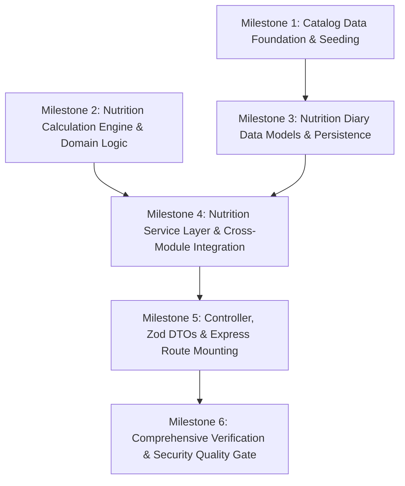

# FitMate AI — Nutrition Core Implementation Plan (`NutritionModule`)

**Document Version:** 1.1.0  
**Phase:** 5.2.1.1 — Nutrition Architecture Design Corrections  
**Status:** **`PROPOSED / READY FOR HUMAN REVIEW`**  
**Date:** 2026-11-02  
**Target Milestone:** Phase 5.2 — Nutrition Core Backend Implementation  
**Author:** Principal Backend Architect & DevSecOps Test Lead  

---

## Document Revision History

| Version | Date | Author | Description of Changes |
| :---: | :---: | :--- | :--- |
| **1.0.0** | 2026-11-02 | Lead Security & DevOps Lead | Initial baseline implementation plan for Phase 5.2.1. |
| **1.1.0** | 2026-11-02 | Principal Backend Architect | **Phase 5.2.1.1 Design Corrections**: <br>1. **Acyclic Domain Architecture**: Placed pure Mifflin-St Jeor engine in leaf domain utility (`energyCalculator.ts`); enforced unidirectional service dependency (`NutritionService` $\rightarrow$ `UsersService`). <br>2. **Search Benchmark Plan**: Added formal automated search latency benchmark harness to Milestone 1 (p50, p95, p99 across 1,000 queries). <br>3. **Roadmap Correction**: Fixed phase numbering (Nutrition Core is Phase 5.2; Workouts Core is Phase 5.3; Coach Core is Phase 5.4). Corrected deletion saga sequence. <br>4. **Recorded Human Decisions**: Script-only seeding (`npm run seed:foods`), optional fiber, custom gram overrides, no custom foods collection. |

---

## 1. Plan Overview & Implementation Philosophy

This document outlines the phased, step-by-step implementation plan for **FitMate AI — Phase 5.2: Nutrition Core Backend**.

### 1.1 Non-Negotiable Implementation Constraints
- **Preserve Existing Modules**: Zero breaking changes to `AuthModule` (Phase 5.1) or `UsersModule`.
- **Approved Architectural Decisions**:
  - No separate `custom_foods` collection in MVP ([DEC-010](file:///d:/2026/Personal%20Fitness%20&%20AI%20Coach%20Platform/FitMate-AI/docs/architecture/MODULE_BOUNDARIES.md#L205)); manual meals are embedded directly via Quick-Add.
  - Local food catalog of ~150–200 foods ([ADR-012](file:///d:/2026/Personal%20Fitness%20&%20AI%20Coach%20Platform/FitMate-AI/docs/architecture/ARCHITECTURE_DECISION_RECORDS.md#L521-L557)); no third-party network APIs during user logging.
  - Estimation transparency: `isEstimated: true` on all calculations ([Core Invariant 2](file:///d:/2026/Personal%20Fitness%20&%20AI%20Coach%20Platform/FitMate-AI/.agents/AGENTS.md#L25-L35), [DB-012](file:///d:/2026/Personal%20Fitness%20&%20AI%20Coach%20Platform/FitMate-AI/docs/architecture/database/DATABASE_ISSUES.md#L100)).
  - Precision tiers: integer calories, 1 decimal place macros ([DB-016](file:///d:/2026/Personal%20Fitness%20&%20AI%20Coach%20Platform/FitMate-AI/docs/architecture/database/DATABASE_ISSUES.md#L158)).
  - Local calendar date key `YYYY-MM-DD` + `timezoneOffsetMinutes` ([DB-017](file:///d:/2026/Personal%20Fitness%20&%20AI%20Coach%20Platform/FitMate-AI/docs/architecture/database/DATABASE_ISSUES.md#L174)).
  - Account deletion saga integration via `purgeUserData(userId)` ([DB-018](file:///d:/2026/Personal%20Fitness%20&%20AI%20Coach%20Platform/FitMate-AI/docs/architecture/database/DATABASE_ISSUES.md#L70)).
  - Seeding executed strictly via explicit migration script `npm run seed:foods` (not on server startup).
- **Zero Mocking of Passed Tests**: Every test must run against real database instances (using `mongodb-memory-server` and Vitest).

---

## 2. Directory Structure Blueprint

Upon implementation, the following file layout will be established in `src/modules/nutrition` and `tests/`:

```
src/modules/nutrition/
├── domain/
│   └── energyCalculator.ts               # Pure leaf arithmetic: Mifflin-St Jeor formula (0 dependencies)
├── dto/
│   └── nutrition.dto.ts                  # Zod validation schemas for all requests/responses
├── models/
│   ├── foodItem.model.ts                 # Mongoose model for food_library collection
│   └── nutritionLog.model.ts             # Mongoose model for nutrition_logs collection
├── seeds/
│   ├── foods.seed.json                   # Curated 150-200 Middle Eastern & staple foods with provenance
│   └── seedFoods.ts                      # Idempotent database seeder (CLI migration script)
├── services/
│   ├── nutrition.calculator.ts           # Pure arithmetic: item scaling, slot & daily aggregations
│   └── nutrition.service.ts              # Business orchestration & UsersModule consumer
├── utils/
│   └── textNormalizer.ts                 # Arabic & English text normalization & search token builder
├── nutrition.controller.ts               # Express request handlers & response envelopes
├── nutrition.repository.ts               # MongoDB queries, atomic updates, and saga purges
└── nutrition.routes.ts                   # Express route definitions & rate limiters

tests/
├── unit/
│   ├── energyCalculator.test.ts          # Unit tests for pure Mifflin-St Jeor formula & safety floors
│   ├── nutrition.calculator.test.ts      # Unit tests for scaling arithmetic & rounding
│   └── textNormalizer.test.ts            # Unit tests for Arabic diacritics & Alef normalization
├── benchmarks/
│   └── foodSearch.bench.ts               # Automated search latency benchmark (1,000 queries)
└── integration/
    ├── nutrition.api.test.ts             # Integration tests for EP-NUTR-001 through EP-NUTR-008
    └── nutrition.security.test.ts        # BOLA / IDOR negative tests & rate-limiting tests
```

---

## 3. Phased Implementation Milestones



---

### Milestone 1: Catalog Data Foundation, Provenance & Seeding
- **Goal**: Establish the `food_library` Mongoose model with full provenance fields, the bilingual text normalization utility, an idempotent database seeder with ~150–200 validated food items, and an automated search benchmark.
- **Files Created / Modified**:
  - `src/modules/nutrition/models/foodItem.model.ts`
  - `src/modules/nutrition/utils/textNormalizer.ts`
  - `src/modules/nutrition/seeds/foods.seed.json`
  - `src/modules/nutrition/seeds/seedFoods.ts`
  - `tests/unit/textNormalizer.test.ts`
  - `tests/benchmarks/foodSearch.bench.ts`
  - `package.json` (add script `"seed:foods": "node --loader ts-node/esm src/modules/nutrition/seeds/seedFoods.ts"`)
- **Dependencies**: Mongoose infrastructure.
- **Acceptance Criteria**:
  - `seedFoods.ts` can be executed repeatedly without generating duplicate documents (`catalogId` uniqueness).
  - All 9 provenance fields are populated on every seeded item (`sourceOrganization`, `sourceDataset`, `preparationState`, etc.).
  - Arabic normalizer strips Tashkeel and normalizes Alef (`أ/إ/آ` $\rightarrow$ `ا`), Taa Marbuta (`ة` $\rightarrow$ `ه`), and Yaa (`ى` $\rightarrow$ `ي`).
  - Search Benchmark: 1,000 randomized queries against 200 items demonstrate p95 latency $\le 50\text{ ms}$.
- **Completion Evidence**: Benchmark output report and Vitest passing `textNormalizer.test.ts`.

---

### Milestone 2: Pure Domain Calculation Engine (Acyclic Decoupling)
- **Goal**: Implement the isolated domain arithmetic engine, decoupling pure Mifflin-St Jeor math into `energyCalculator.ts` and item scaling math into `nutrition.calculator.ts`.
- **Files Created / Modified**:
  - `src/modules/nutrition/domain/energyCalculator.ts`
  - `src/modules/nutrition/services/nutrition.calculator.ts`
  - `tests/unit/energyCalculator.test.ts`
  - `tests/unit/nutrition.calculator.test.ts`
- **Dependencies**: None (pure deterministic mathematical functions with zero imports from services or database).
- **Acceptance Criteria**:
  - `energyCalculator.ts` provides Mifflin-St Jeor target arithmetic with the 1,200 kcal safety floor clamp and `isEstimated: true`.
  - Scaled calories are rounded to integer values; macros to 1 decimal place.
  - Multi-item slot accumulation maintains float64 precision until final decimal rounding.
  - Zero imports of `UsersService` or `NutritionService` in the calculation leaf.
- **Completion Evidence**: 100% test coverage in `energyCalculator.test.ts` and `nutrition.calculator.test.ts`.

---

### Milestone 3: Nutrition Diary Data Models & Persistence
- **Goal**: Implement the `nutrition_logs` Mongoose model with embedded slots, item snapshots, atomic update helpers, and account deletion cleanup.
- **Files Created / Modified**:
  - `src/modules/nutrition/models/nutritionLog.model.ts`
  - `src/modules/nutrition/nutrition.repository.ts`
- **Dependencies**: Milestone 1 (`foodItem.model.ts`).
- **Acceptance Criteria**:
  - Compound unique index on `{ userId: 1, date: 1 }` guarantees exactly one diary document per day.
  - Items logged into a slot capture a complete immutable snapshot (`nameEn`, `nameAr`, `servingWeightGrams`, `calories`, `proteinGrams`, `carbsGrams`, `fatGrams`, `fiberGrams`, `isEstimated: true`).
  - `purgeUserData(userId)` method removes all user records during account deletion.
- **Completion Evidence**: Database integration test verifying atomic `$push` and `$pull` updates.

---

### Milestone 4: Nutrition Service Layer & Cross-Module Integration
- **Goal**: Implement `NutritionService` to orchestrate food search, catalog retrieval, meal logging, and daily diary assembly with `UsersModule` target consumption.
- **Files Created / Modified**:
  - `src/modules/nutrition/services/nutrition.service.ts`
  - In `src/modules/users/users.service.ts`: Expose `getProfileSnapshot(userId)`.
- **Dependencies**: Milestones 1, 2, and 3.
- **Acceptance Criteria**:
  - Invokes `usersService.getProfileSnapshot(userId)` to obtain active targets without reading `user_profiles` directly.
  - Handles empty diary days by returning zero-consumed envelopes with full target budgets.
  - Food search executes bilingual queries with pagination and category filtering.
  - Dependency direction is strictly unidirectional: `NutritionService` $\rightarrow$ `UsersService`.
- **Completion Evidence**: Unit/integration tests asserting service responses.

---

### Milestone 5: Controller, Zod DTOs & Express Route Mounting
- **Goal**: Implement Zod validation schemas, Express controller handlers, route definitions, and mount under `/api/v1/nutrition`.
- **Files Created / Modified**:
  - `src/modules/nutrition/dto/nutrition.dto.ts`
  - `src/modules/nutrition/nutrition.controller.ts`
  - `src/modules/nutrition/nutrition.routes.ts`
  - `src/app.ts` (mount `nutritionRoutes`)
- **Dependencies**: Milestone 4.
- **Acceptance Criteria**:
  - All 8 routes mounted:
    - `GET /api/v1/nutrition/diary`
    - `POST /api/v1/nutrition/meals/quick-add`
    - `POST /api/v1/nutrition/meals/item` (supports standard portion and `customGrams`)
    - `PATCH /api/v1/nutrition/meals/:logId/items/:itemId`
    - `DELETE /api/v1/nutrition/meals/:logId/items/:itemId`
    - `GET /api/v1/nutrition/foods/search`
    - `GET /api/v1/nutrition/foods/:id` (returns full provenance)
    - `GET /api/v1/nutrition/summary`
  - All routes protected by `authMiddleware`.
  - Rate limiters attached (`General Reads`, `Standard Writes`, `Search Cache`).
- **Completion Evidence**: Endpoints respond with HTTP 200/201 in expected envelopes.

---

### Milestone 6: Comprehensive Verification & Security Quality Gate
- **Goal**: Full test suite execution including BOLA negative tests, timezone verification, rate-limit enforcement, and full build check.
- **Files Created / Modified**:
  - `tests/integration/nutrition.api.test.ts`
  - `tests/integration/nutrition.security.test.ts`
- **Dependencies**: All preceding milestones.
- **Acceptance Criteria**:
  - BOLA Defense: User A attempting to modify or delete User B's meal log receives `404 NOT_FOUND`.
  - Timezone Boundary: Logging meals with `X-Timezone-Offset-Minutes` assigns entries to correct local dates without retroactively shifting historical entries.
  - Rate Limiting: Exceeding 60 search requests/minute yields `429 RATE_LIMIT_EXCEEDED`.
  - 100% test pass rate across all suites; `npm run typecheck` and `npm run build` pass with zero errors.
- **Completion Evidence**: Terminal test log with 0 failures.

---

## 4. Risk Register & Mitigation Strategy

| Risk ID | Risk Description | Severity | Likelihood | Mitigation Strategy |
| :--- | :--- | :---: | :---: | :--- |
| **RISK-NUTR-01** | Circular imports between `NutritionModule` and `UsersModule`. | High | Medium | Decouple pure Mifflin-St Jeor math into an isolated domain leaf (`energyCalculator.ts`). Enforce unidirectional dependency: `NutritionService` $\rightarrow$ `UsersService`. |
| **RISK-NUTR-02** | BOLA / IDOR leak across multi-tenant meal logs. | Critical | Low | Scope all queries strictly by `req.user.id`. Return `404 NOT_FOUND` for foreign `logId`. |
| **RISK-NUTR-03** | Date shift bugs across UTC midnight boundaries. | High | High | Key diary documents strictly by local `YYYY-MM-DD` string + `timezoneOffsetMinutes` ([DB-017](file:///d:/2026/Personal%20Fitness%20&%20AI%20Coach%20Platform/FitMate-AI/docs/architecture/database/DATABASE_ISSUES.md#L174)). |
| **RISK-NUTR-04** | Cumulative floating-point errors in macronutrient totals. | Medium | High | Perform calculations in float64; round strictly at persistence setters using `Math.round(val * 10) / 10` ([DB-016](file:///d:/2026/Personal%20Fitness%20&%20AI%20Coach%20Platform/FitMate-AI/docs/architecture/database/DATABASE_ISSUES.md#L158)). |
| **RISK-NUTR-05** | Historical diary values mutating after catalog updates. | High | Medium | Store full immutable nutritional snapshots in `nutrition_logs.slots.*.items`. Do not re-fetch from catalog when reading diary. |

---

## 5. Deletion Saga Roadmap Sequence Alignment ([DB-018](file:///d:/2026/Personal%20Fitness%20&%20AI%20Coach%20Platform/FitMate-AI/docs/architecture/database/DATABASE_ISSUES.md#L70))

The step sequence in the durable operational deletion saga (`deletion_saga_jobs`) is strictly ordered:

```
Step 1: lock_account       (AuthModule / UsersModule — Implemented Phase 5.1)
Step 2: purge_nutrition    (NutritionModule — Contract defined in Phase 5.2)
Step 3: purge_workouts     (WorkoutsModule — Phase 5.3)
Step 4: purge_coach        (CoachModule — Phase 5.4)
Step 5: purge_user_profile (UsersModule — Phase 5.1)
Step 6: purge_auth_user    (AuthModule — Phase 5.1)
Step 7: emit_audit_log     (UsersModule / statutory retention)
```

In Phase 5.2, `NutritionModule` implements its internal purge interface:
```typescript
export async function purgeUserData(userId: string): Promise<number>;
```
The autonomous background worker loop (`DeletionSagaWorker`) will be connected once the subsequent modules exist.
