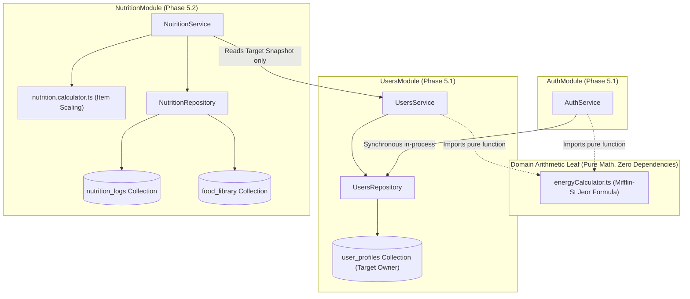

# FitMate AI — Nutrition Core Architecture Specification (`NutritionModule`)

**Document Version:** 1.1.0  
**Phase:** 5.2.1.1 — Nutrition Architecture Design Corrections  
**Status:** **`PROPOSED / READY FOR HUMAN REVIEW`**  
**Date:** 2026-11-02  
**Owning Module:** `NutritionModule`  
**Author:** Principal Backend Architect, Nutrition Domain Engineer & Application Security Architect  

---

## Document Revision History

| Version | Date | Author | Description of Changes |
| :---: | :---: | :--- | :--- |
| **1.0.0** | 2026-11-02 | Lead Security & Backend Architect | Initial baseline architecture specification for Phase 5.2.1. |
| **1.1.0** | 2026-11-02 | Principal Backend Architect | **Phase 5.2.1.1 Design Corrections**: <br>1. **Resolved Circular Dependency**: Decoupled pure Mifflin-St Jeor arithmetic into an isolated domain leaf (`energyCalculator.ts`); established strict unidirectional dependency (`NutritionService` $\rightarrow$ `UsersService`). <br>2. **Target Ownership & Protection**: Reaffirmed `UsersModule` as authoritative owner of target persistence; detailed `isTargetsCustomized` protection. <br>3. **Food Data Provenance**: Defined 9 mandatory provenance fields, specified composite meal representation (Koshari, Mahshi, Hawawshi), and clarified `isVerified` vs `isEstimated`. <br>4. **Reconciled Search Indexing**: Harmonized token prefix indexes with full-text search; replaced unverified latency claims with explicit benchmark plan. <br>5. **Timezone & Date Stability**: Formatted client-authoritative `YYYY-MM-DD` contract and immutable historical log boundaries. <br>6. **Recorded Human Decisions**: Fiber optionality, custom gram overrides, script-based seeding, exclusion of unapproved micronutrients. <br>7. **Roadmap Correction**: Fixed Phase 5.2 roadmap alignment and deletion saga sequence. |

---

## 1. Executive Summary & Module Mission

The `NutritionModule` is the authoritative domain module responsible for daily meal logging, dietary tracking, food catalog search, portion scaling, and energy calculation contracts in FitMate AI.

### 1.1 Core Mission
To provide users with an honest, bilingual (Arabic & English), estimate-transparent, and friction-free daily nutrition diary across four standard meal slots (`breakfast`, `lunch`, `dinner`, `snack`), backed by an offline-curated food catalog of 150–200 Egyptian, Middle Eastern, and international staples, while strictly adhering to FitMate AI's architectural invariants:
1. **Core Invariant 1 (No Medical Claims)**: Nutritional targets and consumed metrics are informational wellness guidance, never prescriptive medical diets or clinical diagnoses.
2. **Core Invariant 2 (Estimation Transparency)**: Every calculated target, portion conversion, logged meal item, slot total, and daily aggregate is explicitly labeled with `isEstimated: true`.
3. **Core Invariant 6 (Bilingual Ergonomics)**: Full native support for Arabic (RTL) and English (LTR) food names, search tokens, aliases, and serving units.
4. **Core Invariant 7 (Multi-Unit Ergonomics)**: Support for Metric (grams, milliliters) and Imperial (ounces, fluid ounces) portion specifications.

---

## 2. Module Dependency Direction & Boundary Architecture

### 2.1 Resolution of Potential Circular Dependencies
In a modular monolith, circular dependencies between vertical slices lead to tight coupling, fragile initialization order, and broken compilation.



### 2.2 Strict Architectural Rules
1. **Authoritative Ownership of User Targets**:
   - `UsersModule` is the **exclusive authoritative owner** of user physical metrics, fitness goals, and persisted nutritional targets stored in `user_profiles`.
   - `NutritionModule` owns **only** daily meal entries (`nutrition_logs`) and the food catalog (`food_library`).
2. **Decoupling Pure Calculation from Persistence**:
   - The Mifflin-St Jeor formula resides in a pure, stateless domain utility:
     `src/modules/nutrition/domain/energyCalculator.ts`.
   - This leaf file has **zero dependencies** on MongoDB models, repositories, or services.
   - `AuthService` (during user registration) and `UsersService` (during profile metric updates) import this pure function directly to calculate baseline targets.
   - `UsersModule` persists the resulting targets into `user_profiles`.
3. **Unidirectional Service Dependency**:
   - `NutritionService` imports `UsersService` to invoke `usersService.getProfileSnapshot(userId)` when preparing the daily diary (`SCR-009`) or summary.
   - `UsersService` **NEVER** imports `NutritionService`.
   - `AuthService` **NEVER** imports `NutritionService`.
   - The dependency graph is strictly a Directed Acyclic Graph (DAG):
     $$\text{NutritionService} \longrightarrow \text{UsersService} \longrightarrow \text{energyCalculator (leaf)}$$

---

## 3. Target Calculation, Persistence & Protection Lifecycle

### 3.1 Calculation Contracts
The pure calculation function conforms to strict input and output interfaces:

```typescript
export interface MetabolicCalculationInput {
  weightKg: number;                   // 30.00 to 300.00 kg
  heightCm: number;                   // 100.0 to 250.0 cm
  birthDate: string;                  // YYYY-MM-DD (age 13-100)
  biologicalSex: 'male' | 'female' | 'prefer_not_to_say';
  activityMultiplier: 1.2 | 1.375 | 1.55 | 1.725 | 1.9;
  goal: 'fat_loss' | 'muscle_gain' | 'recomposition' | 'maintenance' | 'general_fitness' | 'undecided';
}

export interface EnergyTargetsOutput {
  dailyCalorieTarget: number;         // Integer, clamped >= 1200 kcal floor
  proteinTargetGrams: number;         // Float, 1 decimal place
  carbsTargetGrams: number;           // Float, 1 decimal place
  fatTargetGrams: number;             // Float, 1 decimal place
  isEstimated: true;                  // Core Invariant 2
}
```

### 3.2 Target Initialization at Registration
1. Client submits onboarding metrics to `POST /api/v1/auth/register`.
2. `AuthService` passes metrics to `calculateEnergyTargets(input)`.
3. `AuthService` persists user record and passes `EnergyTargetsOutput` along with `isTargetsCustomized: false` and `isEstimated: true` to `UsersRepository.createProfile()`.
4. Persisted values in `user_profiles`:
   - `dailyCalorieTarget`, `proteinTargetGrams`, `carbsTargetGrams`, `fatTargetGrams`.
   - `isTargetsCustomized: false`.
   - `isEstimated: true`.
   - `targetsCalculatedAt: new Date()`.

### 3.3 Protection of Customized Targets
FitMate AI empowers users to set custom nutritional targets:
- If a user customizes their targets via `PATCH /api/v1/users/profile`, `UsersModule` sets `isTargetsCustomized: true`.
- When a user logs a new body weight (e.g. via Weigh-in `SCR-021`), `UsersService` checks:
  ```typescript
  if (!profile.isTargetsCustomized) {
    // Recalculate Mifflin-St Jeor targets from new weight
  } else {
    // PRESERVE user custom targets without modification
  }
  ```
- **Rule**: `NutritionModule` never recalculates, overrides, or mutates user targets under any circumstance.

### 3.4 Future Explicit Recalculation
If a user with customized targets wishes to return to algorithmic baseline targets, they trigger an explicit reset via `POST /api/v1/users/targets/reset` or change their primary goal archetype, which sets `isTargetsCustomized: false` and executes baseline recalculation.

---

## 4. Food Catalog Architecture & Data Provenance

### 4.1 Provenance Specification Fields
To prevent fabricated nutritional data, every item in `food_library` must record comprehensive provenance metadata:

| Field Name | Type | Description | Example |
| :--- | :---: | :--- | :--- |
| `sourceOrganization` | `string` | Authoritative body publishing the data | `'National Nutrition Institute (NNI) Egypt'` |
| `sourceDataset` | `string` | Specific publication, laboratory report, or table | `'Food Composition Tables for Egypt (2006)'` |
| `sourceRecordId` | `string?` | Canonical record identifier in source dataset | `'NNI-EGY-042'` or `'USDA-170934'` |
| `reviewDate` | `string` | Date nutritional data was audited by engineering (YYYY-MM-DD) | `'2026-11-01'` |
| `preparationState` | `enum` | Physical and culinary state of the food | `'cooked'`, `'raw'`, `'boiled'`, `'grilled'`, `'fried'`, `'baked'`, `'canned'` |
| `preparationAssumptions` | `string?` | Standardized preparation assumptions | `'Cooked with 5% vegetable oil and salt'` |
| `confidenceLevel` | `enum` | `'high'` (single-ingredient whole foods) or `'medium'` (composite dishes) | `'high'` |
| `isVerified` | `boolean` | `true` if data originates from certified laboratory tables | `true` |
| `isEstimated` | `boolean` | Always `true` to reflect biological variance (Core Invariant 2) | `true` |

### 4.2 Representation of Composite Egyptian Meals
Composite dishes with variable preparation (e.g., Koshari, Mahshi, Hawawshi, Molokhia):
1. **Institutional Baseline Recipes**: Formulated according to the National Nutrition Institute of Egypt (NNI) standard analytical portions:
   - *Egyptian Koshari*: Standard composite ratio of brown lentils (25%), medium-grain Egyptian rice (35%), elbow pasta (25%), chickpeas (10%), spiced tomato sauce, and fried onions (5%).
   - *Aish Baladi*: Whole wheat flour (82% extraction rate), water, bran (redda), yeast, salt. Standard 1 loaf $\approx 90\text{g}$.
   - *Hawawshi*: Standard baladi bread loaf stuffed with seasoned minced beef (80/20 lean-to-fat ratio), onions, peppers, baked. Standard 1 loaf $\approx 220\text{g}$.
2. **Transparent Culinary Disclaimers**:
   - `confidenceLevel: 'medium'`.
   - `preparationAssumptions: 'Based on Egyptian National Nutrition Institute standardized household recipe. Commercial and restaurant preparations may vary in oil and fat content.'`.

### 4.3 Definition of `isVerified` vs `isEstimated`
- **`isVerified` (Provenance Indicator)**: Signifies that the nutritional values originate from accredited, peer-reviewed scientific databases (USDA FoodData Central, Egyptian NNI, FAO INFOODS) rather than unvetted crowdsourced entries.
- **`isEstimated` (Inherent Biological Invariant)**: Signifies that despite scientific provenance, actual consumed calories and macros have natural variance due to agricultural growth conditions, moisture loss, and home cooking variations. Required on 100% of FitMate nutritional responses.

---

## 5. Bilingual Search Strategy & Benchmark Plan

### 5.1 Reconciled Index Architecture
The MVP catalog comprises 150–200 items. To deliver fast, predictable search across Arabic and English without conflicting index bloat:

```
+---------------------------------------------------------------------------------+
|                         Bilingual Search Index Strategy                         |
+---------------------------------------------------------------------------------+
| 1. Prefix Token Match Index:  { searchTokens: 1, isArchived: 1 }                |
|    - Fast indexed array search for 2-3 character prefixes (e.g. 'fou', 'فول')   |
+---------------------------------------------------------------------------------+
| 2. Full-Text Fallback Index:  { nameEn: 'text', nameAr: 'text', searchAliases: 'text' } |
|    - Default language: 'none' (prevents English stemmer mutilating Arabic)      |
|    - Weights: nameAr: 10, nameEn: 10, searchAliases: 5                          |
+---------------------------------------------------------------------------------+
| 3. Category Filter Index:     { category: 1, isArchived: 1 }                    |
+---------------------------------------------------------------------------------+
```

### 5.2 Query Strategy
1. Input query $q$ is sanitized and normalized using `normalizeSearchText(q)` (Tashkeel removed, Alef normalized to `ا`, Taa Marbuta to `ه`, Yaa to `ي`, English lowercased).
2. If $q$ length is $\le 3$ characters:
   Queries `{ searchTokens: { $regex: '^' + normalizedQ }, isArchived: false }`.
3. If $q$ length is $> 3$ characters:
   Queries MongoDB text search with `$text: { $search: normalizedQ }` or token prefix matching.
4. If category filter is provided, compounds `{ category: filter, isArchived: false }`.

### 5.3 Benchmark Plan (No Unverified Claims)
Rather than asserting speculative latency numbers, Milestone 1 includes an explicit automated benchmark:
- **Dataset**: Exactly 200 fully populated catalog records in `food_library`.
- **Harness**: Vitest benchmark suite executing 1,000 randomized queries (50% Arabic, 50% English, including partial prefixes and transliterations).
- **Target Acceptance SLA**:
  - p50 latency $\le 20\text{ ms}$
  - p95 latency $\le 50\text{ ms}$
  - p99 latency $\le 100\text{ ms}$
- Results must be logged and verified in the Milestone 1 completion evidence.

---

## 6. Diary Date, Timezone & Stability Contract

### 6.1 Ownership of Local Diary Date
- **The Client Device is Authoritative**: The user's active device calendar date at the moment of logging determines the diary date.
- **Format & Validation**: Strict ISO 8601 calendar date `YYYY-MM-DD` validated via Zod regex `/^\d{4}-(0[1-9]|1[0-2])-(0[1-9]|[12]\d|3[01])$/`.

### 6.2 Timezone Offset Semantics ([DB-017](file:///d:/2026/Personal%20Fitness%20&%20AI%20Coach%20Platform/FitMate-AI/docs/architecture/database/DATABASE_ISSUES.md#L174))
- `timezoneOffsetMinutes: number`: The signed difference between UTC and local time in minutes, matching standard ECMAScript `getTimezoneOffset()`:
  - Cairo (UTC+2 standard): `-120` minutes.
  - Cairo (UTC+3 daylight): `-180` minutes.
  - Riyadh (UTC+3): `-180` minutes.
  - New York (UTC-5 EST): `+300` minutes.
- Passed in HTTP request header: `X-Timezone-Offset-Minutes: -120`.

### 6.3 Historical Date Stability Invariant
- **No Retroactive Shifts**: If a user logs meals in Cairo on `2026-11-02` (offset `-120`) and subsequently flies to London (UTC+0, offset `0`) or New York (offset `+300`), the historical diary document for `2026-11-02` **remains permanently assigned to `2026-11-02`**.
- The server **never** retroactively shifts historical diary records based on subsequent timezone changes.
- Individual food entries record a UTC timestamp `loggedAt: new Date()` for chronological sorting within the meal slot, but the root document date string is immutable.

---

## 7. Quick-Add & Historical Snapshot Integrity

### 7.1 Server-Side Calculation & Validation
- **Catalog Items (`POST /api/v1/nutrition/meals/item`)**:
  - Client sends `foodId`, `servingQuantity`, and either `portionId` or `customGrams`.
  - **Server is Authoritative**: The server fetches the catalog record from `food_library` and calculates calories and macros. **Client-sent nutrition totals are strictly ignored** to prevent tampering.
- **Quick-Add Items (`POST /api/v1/nutrition/meals/quick-add`)**:
  - Client sends `calories` (mandatory integer), `proteinGrams`, `carbsGrams`, `fatGrams`, and optional custom `name`.
  - Server validates non-negative bounds and snapshots the values directly.

### 7.2 Immutability of Historical Diary Records
- Every logged item captures an immutable snapshot:
  `{ itemId, foodId, catalogId, nameEn, nameAr, servingUnitNameEn, servingUnitNameAr, servingQuantity, servingWeightGrams, calories, proteinGrams, carbsGrams, fatGrams, isQuickAdd, isEstimated: true, loggedAt }`.
- **Guarantee**: If a food catalog item is updated in v1.1.0 (e.g. refining chicken breast calories from 165 to 160 kcal), **historical user diaries are never modified**.

---

## 8. Recorded Human Product Decisions

The following product decisions are formally recorded across all Phase 5.2 specifications:

1. **Fiber Tracking**: Fiber (`fiberPer100g`, `fiberGrams`) is optional in catalog and diary records. It does **not** appear in the MVP daily summary budget.
2. **Micronutrient Exclusion**: Sodium, potassium, cholesterol, sugar, and vitamins are excluded from the MVP to maintain high-speed UX and minimize cognitive load.
3. **Custom Gram Quantities**: Users can log standard portions (e.g. "1 Loaf") **or** enter custom gram weights directly (`customGrams: 275.0`).
4. **Catalog Seeding**: Performed strictly via an explicit idempotent CLI migration script (`npm run seed:foods`), **not** automatically on server bootstrap.
5. **No Standalone `custom_foods` Collection**: Manual meals are embedded directly via Quick-Add (`DEC-010`).
6. **Camera-Based Recognition**: Deferred to v2.0.
7. **No Autonomous Target Overwrites**: `NutritionModule` never recalculates or modifies user targets.
8. **Roadmap Alignment**: Nutrition Core is **Phase 5.2**. (Workout Core is Phase 5.3; Coach Core is Phase 5.4).

---

## 9. Account Deletion Saga Roadmap Alignment ([DB-018](file:///d:/2026/Personal%20Fitness%20&%20AI%20Coach%20Platform/FitMate-AI/docs/architecture/database/DATABASE_ISSUES.md#L70))

The step sequence in the durable operational deletion saga (`deletion_saga_jobs`) is strictly ordered:

```
Step 1: lock_account       (AuthModule / UsersModule — Implemented Phase 5.1)
Step 2: purge_nutrition    (NutritionModule — Contract defined in Phase 5.2)
Step 3: purge_workouts     (WorkoutsModule — Phase 5.3)
Step 4: purge_coach        (CoachModule — Phase 5.4)
Step 5: purge_user_profile (UsersModule — Phase 5.1)
Step 6: purge_auth_user    (AuthModule — Phase 5.1)
Step 7: emit_audit_log     (UsersModule / statutory retention)
```

In Phase 5.2, `NutritionModule` implements its internal purge interface:
```typescript
export async function purgeUserData(userId: string): Promise<number>;
```
The autonomous background worker loop (`DeletionSagaWorker`) will be connected once the subsequent modules exist.
