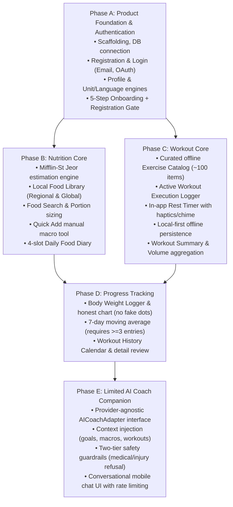

# FitMate AI — Phase 2: Comprehensive Review & Alignment Report

**Document Version:** 1.0.0  
**Phase:** 2 — Product Discovery and Planning (Review & Finalization)  
**Status:** Complete — Pending User Review & Phase Approval  
**Author:** Antigravity Pair Programmer (Product Thinking & Code Review Agent Skills)  
**Date:** 2026-11-01  

---

## 1. Executive Summary

This report documents the comprehensive review, correction, and alignment performed across the complete **Phase 2: Product Discovery and Planning** documentation suite for **FitMate AI**.

Following explicit user approval of six foundational product choices, all nine primary specification documents under `docs/product/` were audited, harmonized, and updated in place. All structural contradictions (including onboarding step counts, Guest Mode assumptions, formula fallbacks, and AI provider lock-in) have been resolved. The product is now fully prepared for user sign-off prior to initiating Phase 3 (Architecture & API Contracts).

---

## 2. Documents Inspected & Modified

### Primary Phase 2 Specification Documents
1. [PRODUCT_OVERVIEW.md](file:///d:/2026/Personal%20Fitness%20&%20AI%20Coach%20Platform/FitMate-AI/docs/product/PRODUCT_OVERVIEW.md) — **Modified**: Updated onboarding journey, phased MVP delivery, Local Food Library, safety invariants, and progress honesty.
2. [MVP_SCOPE.md](file:///d:/2026/Personal%20Fitness%20&%20AI%20Coach%20Platform/FitMate-AI/docs/product/MVP_SCOPE.md) — **Modified**: Structured entire MVP into 5 delivery phases (A through E) with detailed DoD, dependencies, acceptance criteria, and exclusions.
3. [USER_PERSONAS.md](file:///d:/2026/Personal%20Fitness%20&%20AI%20Coach%20Platform/FitMate-AI/docs/product/USER_PERSONAS.md) — **Modified**: Updated Sarah, Tariq, and Zayd profiles to reflect regional foods, honest moving averages, and user-selected deficit pacing.
4. [USER_FLOWS.md](file:///d:/2026/Personal%20Fitness%20&%20AI%20Coach%20Platform/FitMate-AI/docs/product/USER_FLOWS.md) — **Modified**: Updated `UJ-001` (5 steps + Screen 6 registration gate), `UJ-005` (Local food library), `UJ-007` (no fake interpolation), and `UJ-008` (limited AI scope).
5. [SCREEN_INVENTORY.md](file:///d:/2026/Personal%20Fitness%20&%20AI%20Coach%20Platform/FitMate-AI/docs/product/SCREEN_INVENTORY.md) — **Modified**: Explicitly separated 5 onboarding steps (`SCR-001` to `SCR-007B`) from registration gate (`SCR-004`); updated food search and progress charts.
6. [FUNCTIONAL_REQUIREMENTS.md](file:///d:/2026/Personal%20Fitness%20&%20AI%20Coach%20Platform/FitMate-AI/docs/product/FUNCTIONAL_REQUIREMENTS.md) — **Modified**: Updated `FR-AUTH`, `FR-ONBD-004`, `FR-NUTR-001` (BMR vs TDEE, no 2000 kcal fallback), `FR-NUTR-003`, `FR-PROG-001`, and `FR-COACH` (no autonomous mutations).
7. [NON_FUNCTIONAL_REQUIREMENTS.md](file:///d:/2026/Personal%20Fitness%20&%20AI%20Coach%20Platform/FitMate-AI/docs/product/NON_FUNCTIONAL_REQUIREMENTS.md) — **Modified**: Reframed AI latency to a measurable target (p90 < 3.0s); added `NFR-SEC-002` for transient pre-registration data encryption.
8. [OPEN_QUESTIONS.md](file:///d:/2026/Personal%20Fitness%20&%20AI%20Coach%20Platform/FitMate-AI/docs/product/OPEN_QUESTIONS.md) — **Modified**: Converted 9 approved decisions to **APPROVED** status; separated active open questions into a dedicated log.
9. [RISKS_AND_ASSUMPTIONS.md](file:///d:/2026/Personal%20Fitness%20&%20AI%20Coach%20Platform/FitMate-AI/docs/product/RISKS_AND_ASSUMPTIONS.md) — **Modified**: Added `RSK-SAF-004` (clinical dietitian review); updated `RSK-TEC-002` and assumptions `ASM-004` & `ASM-008` to remove provider lock-in.

### Review Report Generated
10. [PHASE_2_REVIEW_REPORT.md](./PHASE_2_REVIEW_REPORT.md) — **Created**: This comprehensive alignment and governance report.

---

## 3. Approved Product Decisions Incorporated

The following nine authoritative decisions are now permanently recorded in [OPEN_QUESTIONS.md](file:///d:/2026/Personal%20Fitness%20&%20AI%20Coach%20Platform/FitMate-AI/docs/product/OPEN_QUESTIONS.md) and applied across all specifications:

```
┌─────────────────────────────────────────────────────────────────────────────┐
│                       AUTHORITATIVE PRODUCT DECISIONS                       │
├─────────┬──────────────────────────┬──────────────────────┬─────────────────┤
│ ID      │ Decision Title           │ Approved Decision    │ Status          │
├─────────┼──────────────────────────┼──────────────────────┼─────────────────┤
│ DEC-001 │ Food Database Sourcing   │ Local Library + Quick│ APPROVED        │
│ DEC-002 │ Exercise Catalog Sourcing│ Curated Offline JSON │ APPROVED        │
│ DEC-003 │ AI Coach Architecture    │ Provider-Agnostic /  │ APPROVED        │
│         │                          │ Limited Capabilities │                 │
│ DEC-004 │ Authentication Gating    │ Mandatory on Screen 6│ APPROVED        │
│ DEC-005 │ Calorie Formula Standard │ Mifflin-St Jeor /    │ APPROVED        │
│         │                          │ Safety Controls      │                 │
│ DEC-006 │ Camera Feature Timeline  │ Strictly Post-MVP v2 │ APPROVED        │
│ DEC-007 │ Monetization Timeline    │ 100% Free Core Alpha │ APPROVED        │
│ DEC-008 │ MVP Phasing Architecture │ Phases A through E   │ APPROVED        │
│ DEC-009 │ Internationalization     │ Arabic RTL & English │ APPROVED        │
│         │                          │ from Release 1.0     │                 │
└─────────┴──────────────────────────┴──────────────────────┴─────────────────┘
```

---

## 4. Key Contradictions Resolved

| Contradiction Identified | Root Issue | Resolution Applied Across All Documents |
| :--- | :--- | :--- |
| **5-Step vs. 6-Screen Onboarding** | Documents inconsistently called the flow "5 steps" while referencing 6 screens. | **Resolved**: Established the architecture as **5 progressive onboarding steps** (`SCR-001` Welcome, `SCR-005` Goals, `SCR-006` Metrics, `SCR-007A` Consent, `SCR-007B` Plan Reveal) followed by a **Mandatory Registration Gate** (`SCR-004` / `SCR-002`). |
| **Guest Mode Ambiguity** | `UJ-001` suggested users could "continue as guest offline", contradicting mandatory authentication. | **Resolved**: Removed all mentions of an unauthenticated Guest Mode or guest data migration. Pre-registration state is held securely in encrypted client memory during onboarding and committed to the user document upon authentication on Screen 6. |
| **Returning User Loop** | Earlier flows lacked an obvious exit for existing users on Screen 1. | **Resolved**: Added a prominent *"I already have an account"* text link on `SCR-001` routing directly to `SCR-002` (Login), bypassing onboarding completely. |
| **Arbitrary Caloric Fallbacks** | `FEAT-009` referenced defaulting to 2,000 kcal if user metrics were invalid or declined. | **Resolved**: Removed arbitrary 2,000 kcal fallbacks. If required inputs are missing or declined, the system prompts the user to configure manual targets or select an unpersonalized baseline. |
| **Rigid Deficit Percentages** | Earlier text prescribed a fixed 15–20% deficit for all fat-loss users. | **Resolved**: Users select their preferred deficit pacing (Mild ~10%, Moderate ~15–20%, or custom), bounded by safety floor guidelines (~1,200/1,500 kcal) that trigger advisory notices. |
| **Fabricated Weight Points** | `FR-PROG-001` suggested linear interpolation across missing days on the weight chart. | **Resolved**: Replaced with strict data honesty: only actual recorded weigh-ins are plotted as points. Missing days are shown as clean gaps. The 7-day moving average curve is displayed only when $\ge 3$ distinct real entries exist. |
| **AI Provider Lock-In** | `DEC-003` and `RSK-TEC-002` assumed Google Gemini 1.5 Flash was the locked provider. | **Resolved**: Decoupled application from any specific vendor. Implemented behind a provider-agnostic `AICoachAdapter` interface, deferring model selection to Phase E. |
| **Guaranteed Response Latency** | Earlier criteria promised a guaranteed $<3.0\,\text{s}$ response time for AI Coach streaming. | **Resolved**: Reframed response time as a **measurable performance target** (target p90 $< 3.0\,\text{s}$), acknowledging LLM provider and network variability. |

---

## 5. Important Corrections Made

1. **Local Food Library with Regional Depth**:
   - Replaced generic food references with a specific local dataset specification (~150–200 foods) containing authentic Egyptian and regional staples (foul mudammas, koshari, taameya, molokhia, grilled chicken, lentils, dates) alongside international staples.
   - Clarified that no external commercial food API is used in the MVP, recording external food APIs as a candidate v1.2 enhancement.
2. **Calorie Estimation & BMR/TDEE Rigor**:
   - Explicitly distinguished BMR (at complete rest) from TDEE (including physical activity multiplier).
   - Labeled activity multipliers as population-level statistical estimates.
   - Ensured all outputs carry `isEstimated: true`.
   - Handled "Prefer not to say" biological sex via a neutral intermediate calculation ($s = -78$) or manual prompt without silent assumptions.
   - Recorded the requirement for formal clinical review by a registered dietitian prior to public release.
3. **AI Coach Guardrails & Autonomous Mutation Prohibition**:
   - Limited MVP scope strictly to fitness education, workout form explanations, exercise substitutions, nutrition concepts, and logged data clarification.
   - Added `FR-COACH-005`: Explicitly forbidden from autonomously altering user profiles, changing calorie targets, or overwriting workout plans without explicit manual user confirmation.

---

## 6. Recommended Phased MVP Delivery Sequence

The MVP implementation is formally organized into five dependency-aware phases. Each phase requires user review and approval before execution commences:



---

## 7. Remaining Active Open Questions & Safety Risks

### Remaining Open Technical Questions (Tracked in `OPEN_QUESTIONS.md`)
1. **Q-001 (LLM Model Selection for Phase E)**: Benchmark Gemini Flash vs. GPT-4o-mini vs. Claude 3.5 Haiku against Arabic fluency, streaming latency, prompt injection resilience, and token cost during Phase E preparation.
2. **Q-002 (Registered Dietitian Review)**: Schedule and execute a formal clinical review of metabolic formula bounds, health disclaimers, and regional food nutritional values prior to public release.
3. **Q-003 (Regional Food Additions)**: Expand local dataset based on user feedback during early testing.
4. **Q-004 (Commercial Food API Evaluation for v1.2)**: Evaluate barcode scanning APIs once core retention is proven.

### Remaining Product & Safety Risks (Tracked in `RISKS_AND_ASSUMPTIONS.md`)
1. **RSK-SAF-001 (AI Hallucination)**: Mitigated by two-tier architecture (deterministic regex filter + system prompt role boundaries) and zero autonomous mutations.
2. **RSK-SAF-002 (Severe Deficits)**: Mitigated by conservative floor guidelines (~1,200/1,500 kcal) triggering health warning notices.
3. **RSK-TEC-001 (Gym Network Outages)**: Mitigated by local-first synchronous storage before issuing network pings.

---

## 8. Final Documentation Consistency Checklist

- [x] **Product Overview agrees with MVP Scope**: Module structures, invariants, and phased delivery sequence match perfectly.
- [x] **MVP Scope agrees with Functional Requirements**: All 24 MVP features (`FEAT-001`–`FEAT-024`) have exact matching requirements (`FR-xxx`) with stable IDs.
- [x] **User Flows agree with Screen Inventory**: All 10 user journeys (`UJ-001`–`UJ-010`) map to valid, existing screen IDs (`SCR-000`–`SCR-025`).
- [x] **Onboarding and Authentication Consistency**: The 5 onboarding steps and Screen 6 registration gate are documented identically across `PRODUCT_OVERVIEW`, `MVP_SCOPE`, `USER_FLOWS`, `SCREEN_INVENTORY`, and `FUNCTIONAL_REQUIREMENTS`.
- [x] **Guest Mode Elimination**: All references to an unauthenticated Guest Mode or guest migration have been removed.
- [x] **Local Food Library Consistency**: Documented across all nutrition sections with regional Egyptian/Middle Eastern staples, Quick Add, and zero commercial API dependencies.
- [x] **BMR vs. TDEE & Estimation Standards**: Corrected across all documents; all numbers labeled `isEstimated: true`; no arbitrary 2,000 kcal fallback.
- [x] **Progress Tracking Honesty**: Chart specifications consistently forbid fabricating or interpolating missing weight entries; moving average requires $\ge 3$ entries.
- [x] **AI Coach Limitations & Provider Agnosticism**: Limited capabilities and provider abstraction interface enforced across all relevant files; response time framed as measurable target.
- [x] **Bilingual & Multi-Unit Parity**: Arabic (RTL) and English (LTR), Cairo font metrics (+25% line-height), and Metric/Imperial support verified across all documents.
- [x] **Decision Registry Updated**: All approved decisions marked `APPROVED` in `OPEN_QUESTIONS.md`; active open questions separated cleanly.
- [x] **Execution Boundaries Honored**: Zero source code, UI components, packages, or databases created.

---

## 9. Next Steps & Approval Request

Phase 2 documentation is now in complete alignment with your approved decisions.

**Action Required**:
Please review and confirm your approval of this Phase 2 Review Report and the revised documentation suite. Upon your explicit confirmation, we will be ready to proceed to **Phase 3: System Architecture & API Contracts**.

