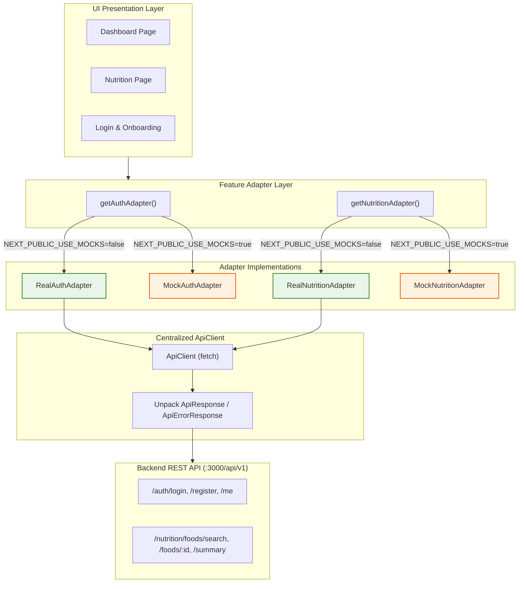

# FitMate AI — FE 0 & FE 1: Frontend Foundation + First Visual Preview Report

**Document Version:** 1.0.0  
**Phase:** FE 0 & FE 1 (Frontend Foundation & First Visual Preview)  
**Status:** **`COMPLETED / VERIFIED`**  
**Date:** 2026-11-02  
**Owning Surface:** Frontend Client Application (`frontend/`)  
**Author:** Senior Frontend & UI/UX Engineer  

---

## 1. Executive Summary & Verification Highlights

The initial frontend foundation (**FE 0**) and first usable visual preview (**FE 1**) for **FitMate AI** have been implemented as an independent web application in `frontend/`.

- **Strict Separation of Concerns**: The existing Node.js + Express backend remains untouched in root. The frontend lives in `frontend/` with its own `package.json`, TypeScript configuration, Tailwind design system, test runner, and scripts.
- **Modern, Accessible Stack**: Next.js 14.2 (App Router), React 18.3, TypeScript 5.7, Tailwind CSS 3.4, and Lucide React.
- **Bilingual & Bi-Directional (EN/AR + LTR/RTL)**: Dynamic full-layout direction and language switching with zero string interpolation leaks and Arabic font accommodations (`Cairo` + `Inter`).
- **Core Invariant 2 Enforced**: `<DisclaimerBadge />` (`isEstimated: true`) is integrated across all caloric summaries, macro breakdowns, and food catalog profiles.
- **High-Fidelity Mock & Real Adapter Boundary**: Centralized `ApiClient` unwraps standard backend envelopes (`ApiResponse<T>`, `PaginatedResponse<T>`, `ApiErrorResponse`). Mock adapters (`MockAuthAdapter`, `MockNutritionAdapter`) provide authentic demo data (Egyptian Koshari, Foul Mudammas, Grilled Chicken Breast, Baladi Bread) when offline or in preview mode, switchable cleanly via `NEXT_PUBLIC_USE_MOCKS`.
- **Quality Gates**:
  - Frontend Vitest Suite: **5 test files passed, 12 tests passed (0 failures)**.
  - TypeScript Typecheck (`tsc --noEmit`): **0 errors**.
  - Next.js Production Build (`next build`): **11 static pages generated successfully, 0 warnings**.
  - Backend Test Suite: **17 test files passed, 141 tests passed (0 failures)** preserved without regressions.

---

## 2. Technology Stack & Rationale

| Layer | Selected Technology | Version | Architectural Rationale |
| :--- | :--- | :---: | :--- |
| **Framework** | Next.js (App Router) | `14.2.23` | Server-driven performance, optimized route streaming, file-based routing, and built-in image/font optimization without client bloat. |
| **Core UI** | React & React DOM | `18.3.1` | Stable foundation with concurrent features, broad ecosystem compatibility with headless UI, and zero peer-dependency conflicts. |
| **Language** | TypeScript (Strict) | `5.7.2` | End-to-end type safety shared conceptually with backend DTOs (`FoodItemSummary`, `DailyNutritionSummary`, `OnboardingFormState`). |
| **Styling** | Tailwind CSS + PostCSS | `3.4.17` | Utility-first, zero-runtime CSS engine, allowing strict design token management, dark mode classes, and bi-directional spacing. |
| **Icons** | Lucide React | `0.468.0` | Accessible, tree-shakeable SVG icon set with clean athletic and navigation symbols (no arbitrary emojis). |
| **Utility** | `clsx` + `tailwind-merge` | `2.1.1` / `2.5.5` | Standard `cn()` utility function for conflict-free dynamic className composition. |
| **Testing** | Vitest + React Testing Library | `2.1.8` / `16.0.1` | Ultra-fast JSDOM-based unit and component test runner matching backend test tooling. |

---

## 3. Final Frontend Folder Architecture

```text
frontend/
├── .env.example                     # Public environment variable template
├── .env.local                       # Local preview development configuration
├── .gitignore                       # Next.js and node_modules exclusions
├── next.config.mjs                  # Production Next.js configuration
├── package.json                     # Standalone frontend scripts and dependencies
├── postcss.config.mjs               # PostCSS with Tailwind & Autoprefixer
├── tailwind.config.ts               # Brand tokens, macro colors, and typography
├── tsconfig.json                    # Strict TypeScript configuration with @/* path alias
├── vitest.config.ts                 # Vitest test runner configuration
├── tests/
│   ├── setup.ts                     # Jest-DOM matchers setup
│   ├── Adapters.test.ts             # Isolation & Core Invariant 2 unit tests
│   ├── Dashboard.test.tsx           # Dashboard visual components tests
│   ├── LanguageContext.test.tsx     # Bilingual & RTL/LTR toggle tests
│   ├── Nutrition.test.tsx           # Search box & food cards tests
│   └── Onboarding.test.tsx          # 5-step registration wizard tests
└── src/
    ├── app/
    │   ├── layout.tsx               # Root HTML layout with LanguageProvider and fonts
    │   ├── page.tsx                 # Root redirect to /dashboard
    │   ├── dashboard/page.tsx       # Main athlete dashboard preview
    │   ├── nutrition/page.tsx       # Nutrition diary & food catalog search preview
    │   ├── workouts/page.tsx        # "Coming Soon" roadmap placeholder
    │   ├── progress/page.tsx        # "Coming Soon" roadmap placeholder
    │   ├── coach/page.tsx           # "Coming Soon" roadmap placeholder
    │   └── auth/
    │       ├── login/page.tsx       # Login screen with Quick Demo access
    │       └── register/page.tsx    # 5-step onboarding wizard screen
    ├── components/
    │   ├── ui/
    │   │   ├── Badge.tsx            # Semantic status and category badge
    │   │   ├── Button.tsx           # Accessible button with 48px touch targets
    │   │   ├── Card.tsx             # Surface container cards
    │   │   ├── DisclaimerBadge.tsx  # Standardized Core Invariant 2 badge
    │   │   ├── Input.tsx            # Form input with RTL support and validation errors
    │   │   ├── Modal.tsx            # Accessible dialog with ESC and backdrop dismiss
    │   │   ├── ProgressBar.tsx      # Macro bars with Coral/Amber/Emerald themes
    │   │   └── Skeleton.tsx         # Content-shaped loading shimmers
    │   └── layout/
    │       ├── AppHeader.tsx        # FitMate branding, language switcher, preview badge
    │       ├── Sidebar.tsx          # Desktop navigation sidebar with route indicators
    │       ├── MobileNav.tsx        # 48dp thumb-zone bottom navigation for mobile
    │       └── ComingSoon.tsx       # Honest, non-pretending feature placeholder
    ├── features/
    │   ├── auth/
    │   │   ├── LoginForm.tsx        # Credentials & demo authentication
    │   │   └── OnboardingWizard.tsx # 5-step approved onboarding wizard
    │   ├── dashboard/
    │   │   ├── CalorieSummaryCard.tsx # Daily target, consumed, and remaining balance
    │   │   ├── MacroProgressCard.tsx  # Protein, Carbs, Fat bars and gram tracking
    │   │   ├── PreviewBanner.tsx      # Prominent demo data notification banner
    │   │   ├── ProgressOverviewCard.tsx # Weight trend preview card
    │   │   ├── QuickActions.tsx       # 4 quick action shortcut cards
    │   │   └── WorkoutOverviewCard.tsx  # Today's workout session preview card
    │   └── nutrition/
    │       ├── FoodDetailModal.tsx  # 100g baseline, portions, custom grams, provenance
    │       ├── FoodResultCard.tsx   # Bilingual food cards with macros per 100g
    │       ├── FoodSearchBox.tsx    # Category pills & live query box
    │       └── MealSlotSection.tsx  # 4 slots: Breakfast, Lunch, Dinner, Snack
    ├── lib/
    │   ├── api/
    │   │   ├── client.ts            # Centralized typed fetch client
    │   │   ├── auth.adapter.ts      # Real vs Mock Auth integration
    │   │   └── nutrition.adapter.ts # Real vs Mock Food Catalog & Diary integration
    │   ├── config/
    │   │   └── env.ts               # Type-safe environment config
    │   ├── i18n/
    │   │   ├── LanguageContext.tsx  # Language, direction, and translation hook
    │   │   └── translations.ts      # Comprehensive EN and AR dictionaries
    │   └── utils.ts                 # `cn()` className merger
    ├── styles/
    │   └── globals.css              # Font variables, scrollbars, and resets
    └── types/
        ├── api.types.ts             # Backend envelope interfaces
        ├── auth.types.ts            # Onboarding form and profile interfaces
        └── nutrition.types.ts       # Food item, portion, and slot interfaces
```

---

## 4. Design System Tokens & Conventions

Aligned with `.agents/skills/design-system/SKILL.md`:

### 4.1 Color Tokens
- **Brand Primary**: Electric Teal / Athletic Cyan (`#0D9488` / `#14B8A6`, tailwind `brand-600` / `brand-500`).
- **Macronutrient Semantic Palette (Immutable Product Standard)**:
  - **Protein**: Coral / Red-Orange (`#EF4444`, `macro-protein`).
  - **Carbohydrates**: Amber / Golden Yellow (`#F59E0B`, `macro-carbs`).
  - **Fats**: Emerald / Mint (`#10B981`, `macro-fat`).
- **Surfaces**:
  - Dark Theme: Deep Charcoal / Slate (`#0B0F17`, `#111827`, `#1F2937`).
  - Light Theme: Crisp Slate Daylight (`#F8FAFC`, `#FFFFFF`, `#F1F5F9`).
- **Semantic Feedback**: Success (`#10B981`), Warning (`#F59E0B`), Error (`#EF4444`), Info (`#3B82F6`).

### 4.2 Typography & Multi-Script Metrics
- **English / Latin**: `Inter`, system-ui, sans-serif.
- **Arabic**: `Cairo`, `Noto Sans Arabic`, sans-serif.
- **Line-Height Multiplier**: Arabic line heights are expanded by `1.25x` to prevent diacritics clipping.

### 4.3 Spacing & Gym Ergonomics
- **8-Point Grid**: 4px micro, 8px, 12px, 16px, 24px, 32px, 48px.
- **Touch Target Sizing**: Minimum interactive element height of **44px – 48px** for one-thumb gym operation.
- **Border Radii**: `sm: 4px`, `md: 8px`, `lg: 12px`, `xl: 16px`, `pill: 9999px`.

---

## 5. Screen Implementations (FE 1 Preview)

### 5.1 Application Layout
- **Desktop Sidebar**: Vertical navigation with active route highlights, badges for in-progress roadmap modules ("Soon / قريباً"), and account shortcuts.
- **Mobile Bottom Bar**: 5-tab navigation bar positioned in the ergonomic thumb zone.
- **Application Header**: FitMate AI logo, prominent "PREVIEW MODE" badge, global `<DisclaimerBadge />`, language toggle button (English / العربية), and user profile pill.
- **Coming Soon Views**: Explicit, non-pretending roadmap screens for `/workouts` (Phase 5.3), `/progress` (Phase 5.4), and `/coach` (Phase 5.5).

### 5.2 Dashboard (`/dashboard`)
- **Preview / Demo Banner**: Informs users that data is simulated for demonstration and provides version context (`v0.1.0`).
- **Daily Calorie Budget Card**: Visual comparison of Daily Target (2,150 kcal), Consumed (1,680 kcal), and Remaining (470 kcal) with responsive percentage bar. Numbers adapt to active locale (`en-US` vs `ar-EG`).
- **Macronutrient Progress Card**: Three distinct bars for Protein (128g / 160g), Carbs (172g / 215g), and Fat (48g / 60g) with strict color coding.
- **Quick Action Cards**: 4 fast shortcuts: "Log Food", "Quick Add", "Start Workout", "Update Weight".
- **Workout & Progress Cards**: Previews of upcoming daily routines and body weight trends.

### 5.3 Nutrition Diary & Food Catalog (`/nutrition`)
- **4-Slot Meal Diary**: Sections for Breakfast, Lunch, Dinner, and Snacks showing items, weights, and slot subtotals.
- **Curated Catalog Search**: Live search input with category filter pills (Egyptian Dishes, Middle Eastern, Poultry, Grains, Dairy, Fruits/Veg, Legumes).
- **Food Result Cards**: Bilingual display (`nameEn` and `nameAr`), calories, protein, carbs, fat per 100g, verified checkmark, and estimation disclaimer.
- **Food Detail Modal**:
  - Interactive portion selector (e.g. "Medium Bowl 350g", "Baladi Sandwich 140g", "Single Breast Fillet 150g").
  - Custom gram weight input with real-time recalculation of calories and macros.
  - **Data Provenance Box**: Displays source organization (e.g. National Nutrition Institute Egypt, USDA FoodData Central), dataset, and preparation state.
  - "Add to Meal Slot" action with affirmative confirmation feedback.

### 5.4 Authentication & 5-Step Onboarding (`/auth/login` & `/auth/register`)
- **Login Screen**: Clean credentials input, error alert banner, and instant "Quick Demo Login" button.
- **5-Step Onboarding Wizard**: Strictly follows backend `registerSchema`:
  1. *Goal & Biological Profile*: Goal buttons (Fat Loss, Muscle Gain, Recomp, etc.), Biological Sex (`male`, `female`, `prefer_not_to_say`), and Birth Date.
  2. *Physical Measurements*: Height and Weight inputs with Metric (kg/cm) and Imperial (lbs/in) switcher.
  3. *Activity & Training*: 5 activity multiplier tiers ($1.2$ to $1.9$) and experience level (beginner, intermediate, advanced).
  4. *Dietary Preferences*: Diet restrictions (None, Halal, Vegetarian, Vegan, Keto, etc.) and preferred app language.
  5. *Consents & Account*: Display name, email, password, and mandatory checkboxes for **Health Disclaimer** (Core Invariant 1) and **Terms of Service**.

---

## 6. Internationalization & Bi-Directional Layout

- **Architecture**: `LanguageContext` wraps the application, exposing `language` (`'en' | 'ar'`), `dir` (`'ltr' | 'rtl'`), `toggleLanguage()`, and `t(key, params)` helper.
- **DOM Reflection**: Dynamically synchronizes `document.documentElement.lang` and `document.documentElement.dir`.
- **RTL Behavior**:
  - Navigation chevrons and arrow icons invert automatically in RTL.
  - Form labels align start-to-end natively (`text-start`, `pe-*`, `ps-*`).
  - Numbers and units maintain standard readability.

---

## 7. API Integration Architecture & Mock Isolation



### Mock Mode Limitations
- Mock adapters simulate realistic response times (150ms–300ms).
- Mock data mutations update client-side React state for the session duration; they do not persist to a database.
- Switching to real endpoints requires the backend to be running on `PORT=3000` with `NEXT_PUBLIC_USE_MOCKS=false`.

---

## 8. Verification & Execution Evidence

### 8.1 Frontend Vitest Suite
```bash
> cd frontend; npm test
# Output:
#  ✓ tests/Nutrition.test.tsx (2 tests) 211ms
#  ✓ tests/Adapters.test.ts (3 tests) 859ms
#  ✓ tests/Dashboard.test.tsx (3 tests) 303ms
#  ✓ tests/LanguageContext.test.tsx (2 tests) 120ms
#  ✓ tests/Onboarding.test.tsx (2 tests) 318ms
# Test Files  5 passed (5)
#      Tests  12 passed (12)
#   Duration  12.17s
```

### 8.2 Frontend TypeScript Typecheck
```bash
> cd frontend; npm run typecheck
# Output:
# > node ./node_modules/typescript/bin/tsc --noEmit
# Exit code: 0 (Zero type errors)
```

### 8.3 Frontend Next.js Production Build
```bash
> cd frontend; npm run build
# Output:
#  ▲ Next.js 14.2.23
#  ✓ Compiled successfully
#  ✓ Generating static pages (11/11)
#  ✓ Finalizing page optimization
# Exit code: 0 (Zero warnings, zero errors)
```

### 8.4 Backend Integrity Check
The existing backend test suite was re-executed from repository root to guarantee zero regression:
```bash
> node ./node_modules/vitest/vitest.mjs run
# Output:
# Test Files  17 passed (17)
#      Tests  141 passed (141)
#   Duration  68.48s
```

---

## 9. How to Run the Frontend Locally

```bash
# 1. Navigate to the frontend directory
cd frontend

# 2. Start the development server (runs on http://localhost:3001)
npm run dev

# 3. Open your browser to view the application:
# http://localhost:3001
# - Login: http://localhost:3001/auth/login
# - Register & Onboarding: http://localhost:3001/auth/register
# - Dashboard: http://localhost:3001/dashboard
# - Nutrition: http://localhost:3001/nutrition
```

---

## 10. Git Status & Safety Audit

The Git working tree was audited:
- Zero files staged or committed (`git add` / `git commit` was not run).
- Backend source files were preserved 100% intact.
- New frontend application files reside exclusively in `frontend/` and documentation in `docs/implementation/`.

```bash
> git status --short
 M package.json
 M src/app.ts
 M src/middleware/rateLimiter.ts
 M src/modules/auth/auth.service.ts
 M src/modules/users/users.service.ts
 M tests/unit/users.service.test.ts
?? docs/implementation/
?? frontend/
?? src/modules/nutrition/
?? tests/integration/foodCatalog.api.test.ts
?? tests/integration/foodSeeding.test.ts
?? tests/unit/energyCalculator.test.ts
?? tests/unit/nutrition.calculator.test.ts
?? tests/unit/textNormalizer.test.ts
```

---

## 11. Conclusion & Next Steps

**FE 0 (Frontend Foundation)** and **FE 1 (First Visual Preview)** are **COMPLETED**.

The frontend application provides a fast, responsive, bilingual visual preview with authentic nutrition items and an interactive 5-step onboarding wizard. All quality gates pass cleanly.

We are ready to await human review before proceeding to **FE 2** or returning to backend **Milestone 3 (Nutrition Diary Data Models & Persistence)**.

