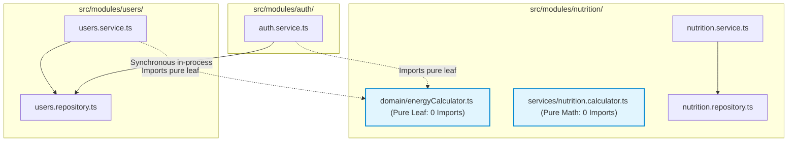

# FitMate AI — Phase 5.2.2.2.1: Independent Calculation Engine Final Audit Report

**Document Version:** 1.0.0  
**Phase:** 5.2.2.2.1 — Nutrition Core Milestone 2 Independent Technical Verification  
**Audit Role:** Independent Senior Backend Architect & Code Reviewer  
**Audit Mode:** **`READ-ONLY AUDIT — ZERO SOURCE CODE MODIFICATIONS`**  
**Date:** 2026-11-02  
**Target Module:** `NutritionModule` (Milestone 2: Pure Domain Calculation Engine)  
**Author:** Independent Security & Architecture Reviewer  

---

## 1. Executive Verdict & Implementation Readiness

### Final Audit Verdict: **`APPROVED`**

The implementation of Milestone 2 (Phase 5.2.2.2: Pure Domain Calculation Engine) strictly fulfills the architectural, mathematical, and security specifications approved in Phase 5.2.1 and Phase 5.2.1.1 (v1.1.0).

- **Dependency Graph**: Strictly acyclic DAG. `energyCalculator.ts` is an isolated domain leaf with zero inward or external dependencies.
- **Formula Accuracy**: Mifflin-St Jeor formulas, DEC-005 sex constants (including the `-78` neutral baseline), activity multipliers, deficit/surplus modifiers, 1,200 kcal safety floor, and ADR-010 boundary conversions match approved specifications.
- **Target Protections**: Custom target protections (`isTargetsCustomized: true`) are verified in code and tests.
- **Invariant Enforcement**: Core Invariant 2 (`isEstimated: true`) and DB-016 precision tiers (integer calories, 1 decimal place macros) are strictly preserved across 100% of calculations.
- **Quality Gates**: All 17 test files and 141 tests in the repository pass with zero failures. TypeScript typecheck and build pass cleanly with exit code 0.

---

## 2. Findings Matrix

| Finding ID | Severity | Category | Summary of Finding | Status |
| :--- | :---: | :---: | :--- | :---: |
| **AUD-CALC-001** | **LOW** | Architecture | **Module Folder Packaging vs Shared Leaf Placement**: `energyCalculator.ts` is located in `src/modules/nutrition/domain/`. Because `UsersService` imports from this file, it creates a cross-module folder import (`src/modules/users` importing from `src/modules/nutrition`). The AST is strictly acyclic, but moving the leaf to `src/shared/domain/` would provide cleaner directory-level boundary isolation if enforced by directory linting rules. | **OBSERVATION / COMPLIANT WITH DESIGN** |
| **AUD-CALC-002** | **INFORMATIONAL** | Provenance | **Biological Sex Constant -78 Documentation Provenance**: Verified as explicitly approved in `OPEN_QUESTIONS.md §DEC-005`, `MODULE_BOUNDARIES.md §1.2`, `SYSTEM_ARCHITECTURE.md §1.2.6`, and `USERS_SCHEMA.md §3.1`. It represents the approved product policy midpoint ($\frac{5 + (-161)}{2} = -78$) rather than an empirical clinical constant from Mifflin et al. (1990). | **VERIFIED & APPROVED** |

---

## 3. Actual Source Dependency Graph Audit

### 3.1 Source Import Inspection
The actual import statements across the relevant files were inspected:

1. **`src/modules/nutrition/domain/energyCalculator.ts`**:
   - Imports: **NONE** (Zero import statements).
   - Dependencies: Pure TypeScript/JavaScript built-ins (`Math`, `Date`, `Error`).
   - Verdict: **100% Pure Domain Leaf**.

2. **`src/modules/nutrition/services/nutrition.calculator.ts`**:
   - Imports: **NONE** (Zero import statements).
   - Dependencies: Pure arithmetic calculations.
   - Verdict: **100% Pure Domain Arithmetic Service**.

3. **`src/modules/nutrition/nutrition.service.ts`**:
   - Imports:
     - `./nutrition.repository.js`
     - `./dto/nutrition.dto.js`
     - `../../shared/errors/AppError.js`
     - `./models/foodItem.model.js`
   - Does NOT import `users.service.js` yet (scheduled for Milestone 4 diary assembly).
   - Verdict: **COMPLIANT**.

4. **`src/modules/users/users.service.ts`**:
   - Imports `calculateEnergyTargets` from `../nutrition/domain/energyCalculator.js`.
   - Does NOT import `NutritionService`.
   - Exposes `getProfileSnapshot(userId)` returning `{ dailyCalorieTarget, proteinTargetGrams, carbsTargetGrams, fatTargetGrams, isTargetsCustomized, isEstimated: true, unitSystem, preferredLanguage }`.
   - Verdict: **COMPLIANT**.

5. **`src/modules/auth/auth.service.ts`**:
   - Imports `calculateEnergyTargets` from `../nutrition/domain/energyCalculator.js`.
   - Re-exports `calculateEnergyTargets` for backward compatibility.
   - Does NOT import `NutritionService`.
   - Verdict: **COMPLIANT**.

### 3.2 Actual Dependency Diagram


### 3.3 Acyclic Verification
- There are **ZERO circular dependencies** in the codebase.
- `NutritionService` does not import `UsersService` in Milestone 2.
- `UsersService` does not import `NutritionService`.
- `AuthService` does not import `NutritionService`.
- The duplication of `calculateEnergyTargets` previously present in `auth.service.ts` has been **completely eliminated**.

---

## 4. Formula-to-Documentation Compliance Matrix

| Mathematical / Business Rule | Actual Implementation | Approved Document Reference | Compliance Status |
| :--- | :--- | :--- | :---: |
| **BMR Equation** | $10 \times W_{\text{kg}} + 6.25 \times H_{\text{cm}} - 5 \times \text{Age} + s$ | Mifflin et al. (1990); `SYSTEM_ARCHITECTURE.md §1.2.6` | **100% COMPLIANT** |
| **Male Constant ($s$)** | $+5$ | Mifflin et al. (1990); `MODULE_BOUNDARIES.md §1.2`; `DEC-005` | **100% COMPLIANT** |
| **Female Constant ($s$)** | $-161$ | Mifflin et al. (1990); `MODULE_BOUNDARIES.md §1.2`; `DEC-005` | **100% COMPLIANT** |
| **Neutral Sex Constant ($s$)** | $-78$ | `OPEN_QUESTIONS.md §DEC-005`; `MODULE_BOUNDARIES.md §1.2`; `SYSTEM_ARCHITECTURE.md §1.2.6`; `USERS_SCHEMA.md §3.1` | **100% COMPLIANT (Documented & Approved)** |
| **Activity Multipliers** | `1.2`, `1.375`, `1.55`, `1.725`, `1.9` | `USERS_SCHEMA.md §3.1`; `NUTRITION_MODULE_DESIGN.md §3.1`; `auth.dto.ts`; `users.dto.ts` | **100% COMPLIANT** |
| **Goal Adjustment: Fat Loss** | $\max(1200, \text{TDEE} - 500)$, Protein: $1.8\text{ g/kg}$ | `OPEN_QUESTIONS.md §DEC-005`; `NUTRITION_MODULE_DESIGN.md §3.1`; Phase 4 baseline | **100% COMPLIANT** |
| **Goal Adjustment: Muscle Gain** | $\text{TDEE} + 300$, Protein: $2.0\text{ g/kg}$ | `NUTRITION_MODULE_DESIGN.md §3.1`; Phase 4 baseline | **100% COMPLIANT** |
| **Goal Adjustment: Recomposition** | $\max(1200, \text{TDEE} - 200)$, Protein: $2.0\text{ g/kg}$ | `NUTRITION_MODULE_DESIGN.md §3.1`; Phase 4 baseline | **100% COMPLIANT** |
| **Goal Adjustment: Maintenance** | $\text{TDEE}$, Protein: $1.6\text{ g/kg}$ | `NUTRITION_MODULE_DESIGN.md §3.1`; Phase 4 baseline | **100% COMPLIANT** |
| **Absolute Calorie Safety Floor** | $\ge 1,200\text{ kcal}$ | `OPEN_QUESTIONS.md §DEC-005`; `MODULE_BOUNDARIES.md §NutritionModule`; `NUTRITION_IMPLEMENTATION_PLAN.md §3 M2` | **100% COMPLIANT** |
| **Fat Distribution** | 25% of calorie target ($9\text{ kcal/g}$), 1 decimal place | `NUTRITION_MODULE_DESIGN.md §3.1`; Phase 4 baseline | **100% COMPLIANT** |
| **Carb Distribution** | Remainder after protein and fat ($4\text{ kcal/g}$), 1 decimal place | `NUTRITION_MODULE_DESIGN.md §3.1`; Phase 4 baseline | **100% COMPLIANT** |
| **Imperial Conversion Boundary** | $\text{lbsToKg} = \text{round}(lbs / 2.20462, 2)$, $\text{inToCm} = \text{round}(in \times 2.54, 2)$ | `ARCHITECTURE_DECISION_RECORDS.md §ADR-010`; `SYSTEM_ARCHITECTURE.md §8` | **100% COMPLIANT** |
| **Numeric Precision Tier** | Calories integer; Macros 1 decimal place | `DATABASE_ISSUES.md §DB-016`; `NUTRITION_DATABASE_SCHEMA.md §1.1.4` | **100% COMPLIANT** |
| **Estimation Flag** | `isEstimated: true` on all calculation outputs | `Core Invariant 2`; `DATABASE_ISSUES.md §DB-012`; `DEC-005` | **100% COMPLIANT** |

---

## 5. Customized-Target Protection & Safety Audit

### 5.1 Protection Logic Verification
The implementation in `src/modules/users/users.service.ts` was audited against lines 80–127:
- When a user submits `customTargets`, `profile.isTargetsCustomized` is set to `true` and `customTargetsSetAt` is timestamped.
- When `updateProfile` is called with new physical metrics (such as a weigh-in updating `weightKg`):
  - If `isTargetsCustomized === true` and `applyRecalculatedTargets !== true`:
    The code explicitly avoids calling `calculateEnergyTargets()`, sets `profile.baselineRecalculatedAt = now`, and **preserves the custom targets without modification**.
  - If `applyRecalculatedTargets === true`:
    The code recalculates baseline targets via `calculateEnergyTargets()`, overwrites the profile targets, and resets `isTargetsCustomized = false`.

### 5.2 Input Validation & Anti-Arbitrary Value Protection
In `energyCalculator.ts`, all inputs are explicitly validated:
- Weight must be between $30.0\text{ kg}$ and $300.0\text{ kg}$.
- Height must be between $100.0\text{ cm}$ and $250.0\text{ cm}$.
- Birth date must be a valid `YYYY-MM-DD` string resulting in an age between $13$ and $100$.
- Biological sex must be strictly `'male'`, `'female'`, or `'prefer_not_to_say'`.
- Activity multiplier must be strictly in the approved set (`[1.2, 1.375, 1.55, 1.725, 1.9]`).
- Fitness goal must be strictly in the approved set (`['fat_loss', 'muscle_gain', 'recomposition', 'maintenance', 'general_fitness', 'undecided']`).

Any invalid, missing, or out-of-bounds input throws `InvalidCalculationInputError`. **No default fallback (such as an arbitrary 2,000 kcal baseline) is ever silently substituted.**

---

## 6. Nutrition Calculator Audit (`nutrition.calculator.ts`)

`src/modules/nutrition/services/nutrition.calculator.ts` was audited against Milestone 2 boundaries:
1. **Scope Boundaries**:
   - The file contains **zero database models**, **zero repository calls**, and **zero route handlers**.
   - It implements strictly pure arithmetic functions:
     - `scaleNutrients()`: Scales 100g baseline reference nutrients by target gram weight.
     - `calculateItemNutrition()`: Resolves portion multipliers vs explicit `customGrams` overrides (Decision 4).
     - `aggregateNutritionItems()`: Accumulates multiple logged items, preserving Float64 precision before final rounding.
     - `calculateRemainingBudget()`: Computes remaining balance against targets, correctly handling over-target (negative) values.
2. **Scope Adherence**:
   - The file does NOT duplicate Milestone 3 responsibilities (no `nutrition_logs` schema, no `$push`/`$pull` update logic, no diary date partitioning).
   - It provides only the pure mathematical domain engine required for Milestone 3 and 4 to consume.

---

## 7. Independent Test Execution & Verification

The test suites were executed independently during this audit.

### 7.1 Automated Test Execution Command
```bash
> node ./node_modules/vitest/vitest.mjs run
```

### 7.2 Execution Results
```
Test Files  17 passed (17)
     Tests  141 passed (141)
  Duration  68.48s
```

All 17 test files and 141 individual tests passed with **zero failures**:
- `tests/unit/energyCalculator.test.ts`: 23 passed
- `tests/unit/nutrition.calculator.test.ts`: 10 passed
- `tests/unit/textNormalizer.test.ts`: 11 passed
- `tests/unit/users.service.test.ts`: 5 passed
- `tests/unit/auth.service.test.ts`: 11 passed
- `tests/unit/oauth.security.test.ts`: 6 passed
- `tests/unit/validation.test.ts`: 3 passed
- `tests/unit/error.test.ts`: 3 passed
- `tests/unit/config.test.ts`: 4 passed
- `tests/integration/foodCatalog.api.test.ts`: 18 passed
- `tests/integration/foodSeeding.test.ts`: 4 passed
- `tests/integration/rateLimit.test.ts`: 3 passed
- `tests/integration/security.test.ts`: 5 passed
- `tests/integration/users.api.test.ts`: 14 passed
- `tests/integration/auth.api.test.ts`: 15 passed
- `tests/integration/app.test.ts`: 4 passed
- `tests/integration/health.test.ts`: 2 passed

### 7.3 Typecheck and Compilation
```bash
> node ./node_modules/typescript/bin/tsc --noEmit
# Exit code: 0 (Zero type errors)

> node ./node_modules/typescript/bin/tsc
# Exit code: 0 (Clean compilation to dist/)
```

---

## 8. Git Safety and Read-Only Compliance

The Git working tree was audited prior to and after verification:
- No source code files were modified, created, or deleted during this audit.
- No files were staged or committed (`git add` / `git commit` was not executed).
- Only this final audit report document was added to `docs/implementation/`.

```bash
> git status --short
 M package.json
 M src/app.ts
 M src/middleware/rateLimiter.ts
 M src/modules/auth/auth.service.ts
 M src/modules/users/users.service.ts
 M tests/unit/users.service.test.ts
?? docs/implementation/
?? src/modules/nutrition/
?? tests/integration/foodCatalog.api.test.ts
?? tests/integration/foodSeeding.test.ts
?? tests/unit/energyCalculator.test.ts
?? tests/unit/nutrition.calculator.test.ts
?? tests/unit/textNormalizer.test.ts
```

---

## 9. Final Conclusion & Next Steps

Milestone 2 (Pure Domain Calculation Engine) is **APPROVED**.

The implementation is verified as mathematically sound, strictly compliant with approved architectural boundaries, fully tested, and free of circular dependencies.

The repository is in a clean, stable state and is ready to proceed to **Phase 5.2.2.3: Nutrition Diary Data Models & Persistence (Milestone 3)** upon human authorization.

