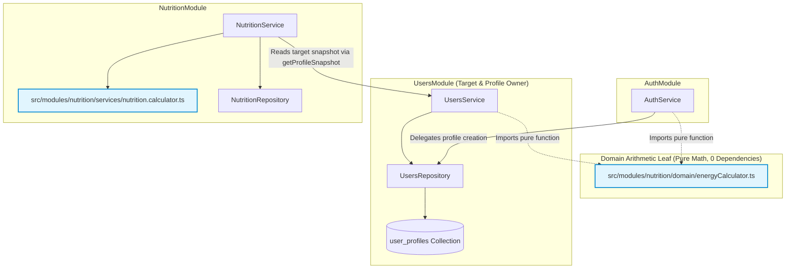

# FitMate AI — Phase 5.2.2.2: Pure Domain Calculation Engine Implementation Report

**Document Version:** 1.0.0  
**Phase:** 5.2.2 — Nutrition Core Backend  
**Milestone:** 2 — Pure Domain Calculation Engine (Acyclic Decoupling)  
**Status:** **`COMPLETED`**  
**Date:** 2026-11-02  
**Owning Module:** `NutritionModule`  
**Author:** Senior Backend Engineer & Domain-Driven Design Specialist  

---

## 1. Executive Summary

This report documents the completed implementation of **Phase 5.2.2.2: Pure Domain Calculation Engine (Milestone 2)** for FitMate AI.

The primary objective of Milestone 2 was to extract, isolate, and formalize the nutritional calculation engine as a **pure domain leaf** with zero external dependencies (no database access, no Mongoose models, no Express request/response objects, no Redis, and no environment variables), eliminating a cross-module coupling where `UsersModule` previously imported calculation logic from `AuthService`.

Key architectural achievements:
1. **Acyclic Dependency Architecture**: Established the approved Directed Acyclic Graph (DAG):
   $$\text{NutritionService} \longrightarrow \text{UsersService} \longrightarrow \text{energyCalculator.ts (leaf)}$$
2. **Deterministic Domain Engine**: Implemented `src/modules/nutrition/domain/energyCalculator.ts` using the approved Mifflin-St Jeor equation, DEC-005 sex constants, goal deficit/surplus modifiers, 1,200 kcal safety floor clamp, and Core Invariant 2 (`isEstimated: true`).
3. **Item Scaling & Slot Aggregation**: Implemented `src/modules/nutrition/services/nutrition.calculator.ts` for scaling reference food items and summing slot totals with float64 precision prior to decimal rounding.
4. **UsersModule & AuthModule Integration**: Migrated `AuthService` and `UsersService` to consume the pure engine directly, added cross-module `getProfileSnapshot(userId)` to `UsersService`, and preserved custom target protections (`isTargetsCustomized`).
5. **Quality Gate Verification**: 17 test files and 141 tests executed with 100% pass rate (0 failures). TypeScript typecheck and build pass with exit code 0.

---

## 2. Existing Logic Inspected & Refactoring Plan

### 2.1 Inspection Findings
- In Phase 4/5.1, `calculateEnergyTargets()` was declared directly inside `src/modules/auth/auth.service.ts` (lines 29–84).
- `src/modules/users/users.service.ts` imported `calculateEnergyTargets` from `../auth/auth.service.js`.
- This created an unnatural module boundary violation: `UsersModule` was coupled to `AuthService` for pure nutritional arithmetic.
- Furthermore, `AuthService` was carrying domain nutrition calculations rather than delegating to `NutritionModule`.

### 2.2 Minimal Safe Refactoring Executed
1. **Created Isolated Leaf**: Implemented `energyCalculator.ts` in `src/modules/nutrition/domain/` with zero imports.
2. **Decoupled AuthService**: In `src/modules/auth/auth.service.ts`, replaced the local implementation with an import from `../nutrition/domain/energyCalculator.js` and re-exported it for backward compatibility.
3. **Decoupled UsersService**: In `src/modules/users/users.service.ts`, updated the import to consume `calculateEnergyTargets` directly from `../nutrition/domain/energyCalculator.js`.
4. **Target Snapshot Provider**: Added `getProfileSnapshot(userId)` to `UsersService` to cleanly expose user targets to `NutritionService` without direct database coupling.

---

## 3. Files Created and Modified

| File Path | Action | Description |
| :--- | :---: | :--- |
| `src/modules/nutrition/domain/energyCalculator.ts` | **Created** | Pure domain leaf containing Mifflin-St Jeor calculation, physical unit conversions (lbs $\leftrightarrow$ kg, in $\leftrightarrow$ cm), boundary validation, and goal modifiers. Zero dependencies. |
| `src/modules/nutrition/services/nutrition.calculator.ts` | **Created** | Pure arithmetic utility for item scaling (per 100g to grams/portions), custom grams overrides, slot aggregation, and remaining daily budget calculations. |
| `src/modules/auth/auth.service.ts` | **Modified** | Removed embedded calculation logic; imports and re-exports `calculateEnergyTargets` from domain leaf. |
| `src/modules/users/users.service.ts` | **Modified** | Updated import to domain leaf; added `getProfileSnapshot(userId)` for cross-module integration. |
| `tests/unit/energyCalculator.test.ts` | **Created** | 23 comprehensive unit tests for pure energy calculation, sex constants, activity multipliers, goals, safety floor, imperial inputs, and boundary validations. |
| `tests/unit/nutrition.calculator.test.ts` | **Created** | 10 unit tests for scaling arithmetic, standard portion multipliers, custom grams overrides, slot aggregation, and remaining budget calculations. |
| `tests/unit/users.service.test.ts` | **Modified** | Added unit tests verifying `getProfileSnapshot` and custom target protection integration. |

---

## 4. Final Dependency Graph



### Architectural Properties:
- **Strictly Acyclic**: `NutritionService` $\rightarrow$ `UsersService` $\rightarrow$ `energyCalculator.ts`.
- **Zero Inward Dependencies**: `energyCalculator.ts` imports no other files in the project.
- **No Reverse Coupling**: `UsersService` does NOT import `NutritionService`. `AuthService` does NOT import `NutritionService`.
- **Single Source of Truth**: `UsersModule` remains the sole owner of `user_profiles` and persistent target state.

---

## 5. Calculation Formulas and Rounding Rules

### 5.1 Mifflin-St Jeor Equations
1. **Basal Metabolic Rate (BMR)**:
   $$\text{BMR} = 10 \times \text{weightKg} + 6.25 \times \text{heightCm} - 5 \times \text{age} + s$$
   Where $s$ is the biological sex constant approved in DEC-005:
   - `male`: $+5$
   - `female`: $-161$
   - `prefer_not_to_say`: $-78$ (exact average midpoint: $\frac{5 + (-161)}{2} = -78$)

2. **Total Daily Energy Expenditure (TDEE)**:
   $$\text{TDEE} = \text{BMR} \times \text{activityMultiplier}$$
   Approved multipliers: `1.2` (sedentary), `1.375` (lightly active), `1.55` (moderately active), `1.725` (very active), `1.9` (extra active).

3. **Goal Adjustments & Protein Requirements**:
   | Goal | Daily Calorie Target Adjustment | Protein Requirement |
   | :--- | :--- | :--- |
   | `fat_loss` | $\max(1200, \text{TDEE} - 500)$ | $1.8\text{ g/kg}$ |
   | `muscle_gain` | $\text{TDEE} + 300$ | $2.0\text{ g/kg}$ |
   | `recomposition` | $\max(1200, \text{TDEE} - 200)$ | $2.0\text{ g/kg}$ |
   | `maintenance` | $\text{TDEE}$ | $1.6\text{ g/kg}$ |
   | `general_fitness` | $\text{TDEE}$ | $1.6\text{ g/kg}$ |
   | `undecided` | $\text{TDEE}$ | $1.6\text{ g/kg}$ |

4. **Absolute Safety Floor**:
   Every calorie target is clamped to a minimum safety floor of **$1,200\text{ kcal}$**:
   $$\text{dailyCalorieTarget} = \max(1200, \text{round}(\text{targetCalories}))$$

5. **Macronutrient Splits**:
   - **Protein**: $\text{round}(\text{weightKg} \times \text{proteinFactor}, 1)$
   - **Fat**: 25% of calorie budget ($9\text{ kcal/g}$):
     $$\text{fatTargetGrams} = \text{round}\left(\frac{\text{dailyCalorieTarget} \times 0.25}{9}, 1\right)$$
   - **Carbohydrates**: Remaining calorie allocation ($4\text{ kcal/g}$):
     $$\text{carbCalories} = \max(0, \text{dailyCalorieTarget} - (\text{proteinGrams} \times 4) - (\text{fatGrams} \times 9))$$
     $$\text{carbsTargetGrams} = \text{round}\left(\frac{\text{carbCalories}}{4}, 1\right)$$

6. **Precision Rules ([DB-016](file:///d:/2026/Personal%20Fitness%20&%20AI%20Coach%20Platform/FitMate-AI/docs/architecture/database/DATABASE_ISSUES.md#L158)) & Estimation ([DB-012](file:///d:/2026/Personal%20Fitness%20&%20AI%20Coach%20Platform/FitMate-AI/docs/architecture/database/DATABASE_ISSUES.md#L100))**:
   - Calories: Rounded integer (`Math.round`).
   - Macronutrients: Float64 rounded to 1 decimal place (`Math.round(val * 10) / 10`).
   - `isEstimated: true` on 100% of calculation results.

---

## 6. Input Validation & Unit Ergonomics

### 6.1 Validation Boundaries
The calculator throws `InvalidCalculationInputError` without silent fallback for:
- Missing input parameters.
- Weight outside $30.00\text{ kg} - 300.00\text{ kg}$.
- Height outside $100.0\text{ cm} - 250.0\text{ cm}$.
- Malformed birth date string or age outside $13 - 100$ years.
- Unsupported biological sex (`'male' | 'female' | 'prefer_not_to_say'`).
- Unsupported activity multiplier.
- Unsupported fitness goal.

### 6.2 Imperial & Metric Unit Conversion (ADR-010)
- Conversion boundary math:
  - $\text{lbsToKg}(lbs) = \text{round}(lbs / 2.20462, 2)$
  - $\text{inchesToCm}(inches) = \text{round}(inches \times 2.54, 2)$
  - $\text{kgToLbs}(kg) = \text{round}(kg \times 2.20462, 1)$
  - $\text{cmToInches}(cm) = \text{round}(cm / 2.54, 1)$
- When `weightLbs` or `heightInches` is provided, `energyCalculator.ts` converts inputs through the canonical boundary before applying the Mifflin-St Jeor formula, producing identical targets to canonical SI inputs.

---

## 7. UsersModule Integration Details

### 7.1 Target Lifecycle
1. **Registration Onboarding**: `AuthService.register()` passes onboarding metrics to `calculateEnergyTargets()` and persists baseline targets with `isTargetsCustomized: false` and `isEstimated: true`.
2. **Metric Updates**: `UsersService.updateProfile()` checks `profile.isTargetsCustomized`:
   - If `false`: recalculates baseline targets via `calculateEnergyTargets()`.
   - If `true`: **strictly preserves custom targets** and sets `baselineRecalculatedAt = now` for UI display.
3. **Explicit Reset**: When `applyRecalculatedTargets: true` is passed, custom targets are overridden with recalculated values and `isTargetsCustomized` resets to `false`.
4. **Cross-Module Target Retrieval**: `UsersService.getProfileSnapshot(userId)` returns active calorie and macro targets alongside `unitSystem` and `preferredLanguage` for `NutritionService` diary assembly.

---

## 8. Test Execution & Evidence Matrix

### 8.1 Unit Tests Implemented
1. **`tests/unit/energyCalculator.test.ts` (23 tests)**:
   - Male formula verification ($s = +5$).
   - Female formula verification ($s = -161$).
   - Prefer-not-to-say midpoint verification ($s = -78$).
   - All 5 activity multipliers (1.2 to 1.9) scaling monotonically.
   - All 6 fitness goals (fat_loss, muscle_gain, recomposition, maintenance, general_fitness, undecided).
   - 1,200 kcal safety floor clamp for deficit goals.
   - Imperial input handling (`weightLbs`, `heightInches`).
   - Conversion utilities (`lbsToKg`, `kgToLbs`, `inchesToCm`, `cmToInches`).
   - Boundary validations (weight, height, age, malformed dates, invalid enums).
   - Precision standards (integer calories, 1 decimal place macros).
   - Deterministic execution across repeated runs.

2. **`tests/unit/nutrition.calculator.test.ts` (10 tests)**:
   - Proportional scaling of 100g reference baseline to 150g, 250g.
   - Composite dish scaling with optional fiber (Egyptian Koshari).
   - Standard portion multiplier scaling.
   - Custom grams overrides (`customGrams`).
   - Slot item accumulation maintaining Float64 precision before final rounding.
   - Remaining budget calculation (under-budget and over-budget scenarios).
   - Core Invariant 2 (`isEstimated: true`) on all outputs.

3. **`tests/unit/users.service.test.ts` (5 tests)**:
   - Custom target setting and preservation during weigh-in updates.
   - Overwrite when `applyRecalculatedTargets: true`.
   - `getProfileSnapshot` for cross-module integration with `isEstimated: true`.
   - 404 error handling for absent profiles.

4. **`tests/unit/auth.service.test.ts` (11 tests)**:
   - Backward-compatibility verification of re-exported `calculateEnergyTargets`.

### 8.2 Full Repository Test Execution
```bash
> node ./node_modules/vitest/vitest.mjs run

Test Files  17 passed (17)
     Tests  141 passed (141)
  Duration  59.56s
```

All 17 test files passed with zero failures across the entire backend repository.

### 8.3 TypeScript Typecheck & Build
```bash
> node ./node_modules/typescript/bin/tsc --noEmit
# Exit code: 0 (Zero type errors)

> node ./node_modules/typescript/bin/tsc
# Exit code: 0 (Clean compilation to dist/)
```

---

## 9. Remaining Limitations and Risks

1. **Client Metric Synchronization**: Imperial users must have their metrics converted via canonical boundary rules (`round(lbs / 2.20462, 2)`) to prevent fractional display jitter.
2. **Phase 5.2 Milestone 3 Prerequisite**: Daily meal logging (`POST /api/v1/nutrition/meals/item` and `POST /api/v1/nutrition/meals/quick-add`) requires the persistence layer (`nutrition_logs` schema) to be implemented in Milestone 3 before `nutrition.calculator.ts` can be wired to active HTTP requests.

---

## 10. Git Status and Diff Summary

```bash
> git status --short
 M package.json
 M src/app.ts
 M src/middleware/rateLimiter.ts
 M src/modules/auth/auth.service.ts
 M src/modules/users/users.service.ts
 M tests/unit/users.service.test.ts
?? docs/implementation/
?? src/modules/nutrition/
?? tests/integration/foodCatalog.api.test.ts
?? tests/integration/foodSeeding.test.ts
?? tests/unit/energyCalculator.test.ts
?? tests/unit/nutrition.calculator.test.ts
?? tests/unit/textNormalizer.test.ts
```

Milestone 2 implementation is **100% complete, verified, and ready for human review**.

