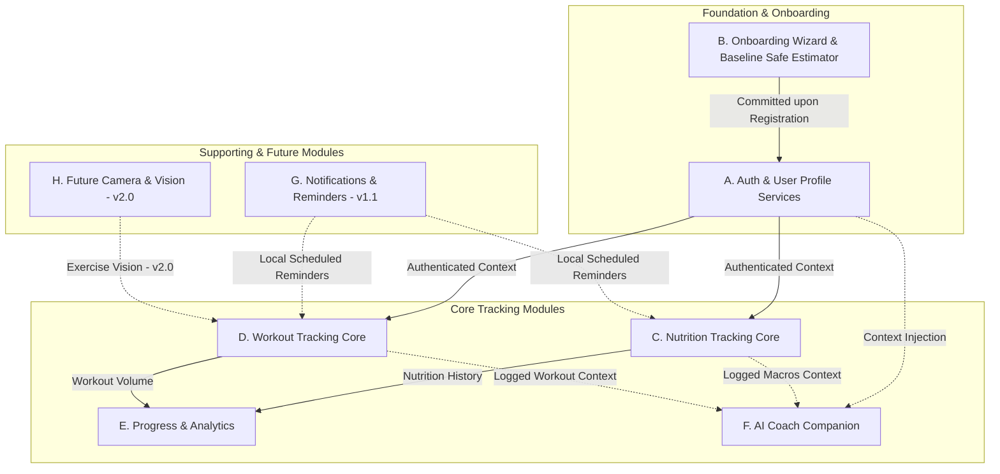
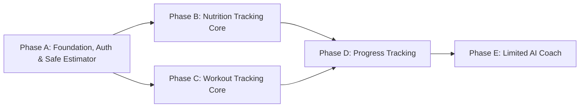

# FitMate AI — Product Overview & Strategic Foundation

**Document Version:** 2.1.0  
**Phase:** 2 — Product Discovery and Planning (Review & Consistency Update)  
**Status:** Approved Product Decisions Incorporated  
**Author:** Product Thinking, Mobile UI/UX & Design System Agent Skills  

---

## 1. Executive Summary

**FitMate AI** is a premium, mobile-first fitness and nutrition application engineered to help diverse individuals build sustainable physical health habits. It merges frictionless workout tracking, estimated caloric and macronutrient management, longitudinal body progress analytics, and an intelligent, context-aware AI fitness and nutrition coach operating within strict, safe boundaries.

Unlike conventional fitness applications that assume a single "standard" athlete archetype (typically young, experienced gym-goers targeting aggressive muscle hypertrophy or severe fat loss), FitMate AI is intentionally architected to accommodate **universal personalization**. It provides tailored experiences for beginners, weight-loss seekers, muscle-builders, body-recomposition athletes, maintenance-focused individuals, and users who are undecided about their fitness goals.

FitMate AI treats **safety, privacy, internationalization, and local-first reliability** as foundational primitives rather than retrofitted features. The platform provides full native support for **Arabic (RTL)** and **English (LTR)** from the first release, seamless switching between **Metric** and **Imperial** units, and strict ethical boundaries ensuring that AI coaching remains strictly informational, non-medical, and bound to estimated nutrition standards.

---

## 2. Product Vision & Value Proposition

### 2.1 Product Vision Statement
> *"To empower every individual—regardless of starting fitness level, language, or physical goal—with an intuitive, empathetic, and intelligent daily companion that removes the friction of fitness tracking and delivers evidence-based, safe health guidance."*

### 2.2 Core Value Propositions

```
┌─────────────────────────────────────────────────────────────────────────────┐
│                           FITMATE AI VALUE PILLARS                          │
├───────────────────────┬──────────────────────────┬──────────────────────────┤
│ 1. Zero-Friction      │ 2. Universal             │ 3. Empathetic, Safe      │
│    Execution          │    Inclusivity           │    AI Coaching           │
├───────────────────────┼──────────────────────────┼──────────────────────────┤
│ • Log sets in <4 taps │ • Tailored goals: Fat    │ • Context-aware coaching │
│ • Rest timer alerts   │   loss, Muscle gain,     │   aligned to user logs   │
│ • Offline-first gym   │   Recomp, Maintenance,   │ • Zero medical claims    │
│   reliability         │   General, Undecided     │ • Explicit nutrition     │
│ • Local food library  │ • Native Arabic (RTL) &  │   estimation disclaimers │
│   with regional foods │   English (LTR)          │ • Safe, non-judgmental   │
│ • Quick-Add macros    │ • Metric & Imperial      │   habit reinforcement    │
└───────────────────────┴──────────────────────────┴──────────────────────────┘
```

1. **Frictionless Daily Tracking**: Active workout logging and food recording are designed to be completed in seconds. The gym interface accommodates sweaty hands, high glare, and intermittent network connectivity through a local-first design.
2. **Universal Personalization**: The app never forces a default 2,000 kcal diet or standard 5-day bodybuilding split. Goals, caloric budgets, macro distributions, and exercise selections adapt dynamically to user metrics, experience, and lifestyle constraints.
3. **Evidence-Based & Ethically Bounded AI**: The AI Coach operates within verified fitness and wellness guardrails, proactively discouraging extreme caloric deficits, unsafe training behaviors, and never claiming to be a doctor, dietitian, or clinical diagnostic system. The AI cannot autonomously alter user profiles or targets.
4. **Bilingual & Bi-Directional Parity**: English and Arabic experiences are treated with identical design priority from the initial release, ensuring natural typographic ergonomics, proper reading orders, and culturally sensitive interaction patterns.

---

## 3. Main User Problems & Market Deficiencies

FitMate AI directly resolves five critical failure modes prevalent in existing commercial fitness applications:

| Problem ID | Market Friction in Existing Apps | FitMate AI Solution |
| :--- | :--- | :--- |
| **PRB-001** | **Excessive In-Workout Logging Friction**: Trainees are forced to navigate deep nested menus, view intrusive video ads, or manually re-type previous weights between heavy sets. | Single-tap set completion with pre-populated weights/reps from prior sessions, integrated rest timers, and zero intrusive ads. |
| **PRB-002** | **Rigid, Monolithic Goal Assumptions**: Apps assume extreme cutting or bulking goals, alienating maintenance seekers, busy professionals, and undecided beginners. | Dedicated onboarding and profile paths for 6 distinct goal archetypes, including custom baselines and undecided exploratory guidance. |
| **PRB-003** | **Network Sensitivity in Gym Basements**: Cloud-only apps freeze, drop sets, or fail to load exercise descriptions when gym connectivity drops. | Local-first optimistic UI architecture that records workout sessions locally and synchronizes transparently when internet access resumes. |
| **PRB-004** | **Misleading Nutrition Guarantees**: Apps present calculated calorie counts as absolute scientific fact, creating user anxiety and ignoring natural metabolic variances. | Mandatory `isEstimated: true` labeling and clear metabolic estimation disclaimers on every nutrition view. |
| **PRB-005** | **Superficial Arabic & RTL Support**: Global apps frequently treat Arabic as an afterthought, with broken reversed text, clipped diacritics, and backwards progression meters. | Native bi-directional layout architecture with Cairo/Noto typography adjusted for Arabic vertical ascenders/descenders (+25% line-height) and mirrored interaction ergonomics from day 1. |

---

## 4. Core Product Invariants & Non-Negotiable Boundaries

Every screen, endpoint, prompt, and specification across FitMate AI must strictly uphold these ten persistent invariants:

1. **INV-001: No Medical Claims or Clinical Diagnoses**: The AI Coach is an informational wellness companion. It must never diagnose injuries, prescribe medical treatments, suggest prescription medications, or evaluate bloodwork. All health screens carry standard disclaimers advising consultation with licensed healthcare providers.
2. **INV-002: Transparent Nutrition Estimation**: All caloric requirements, expenditure calculations, and macronutrient totals are explicitly labeled as estimates (`isEstimated: true`). The app explicitly educates users that nutritional science relies on statistical estimations rather than laboratory measurements.
3. **INV-003: Conservative Caloric Floor Guidelines & Health Safeguards**: The platform refuses to recommend or validate extreme, dangerous caloric deficits. Conservative baseline floor guidelines (~1,200 kcal/day for adult females and ~1,500 kcal/day for adult males) serve strictly as **advisory warning thresholds to trigger prominent health notice banners**, not universal medical guarantees. No caloric intake is described as medically safe merely because it exceeds a threshold. Individual metabolic needs vary based on body mass, age, and activity. The system never forces an arbitrary universal calorie fallback (such as a generic 2,000 kcal default) and requires professional review by a registered dietitian prior to release.
4. **INV-004: Explicit Consent for Sensitive Data**: Access to camera hardware (future), device health stores, and personal health metrics requires unambiguous, separate, and revocable user consent.
5. **INV-005: Data Minimization & Privacy Protection**: The platform persists only data strictly necessary for active feature calculation. Sensitive metrics are never sold, shared with ad networks, or exposed in unmasked application logs.
6. **INV-006: Universal Persona Invariance**: The platform must never hard-code single-user assumptions regarding body weight, gender, basal metabolic rate, training volume, or food preferences.
7. **INV-007: Bilingual & Bi-Directional Parity**: Full feature, visual, and operational parity between English (LTR) and Arabic (RTL) from the first release.
8. **INV-008: Multi-Unit Coexistence**: All data storage is normalized to standard base units internally while providing dynamic, lossless presentation in either Metric (kg, cm, ml) or Imperial (lbs, in, fl oz) systems.
9. **INV-009: Data Honesty in Progress Tracking**: The platform never fabricates or interpolates missing weight measurements. Moving averages are displayed only when sufficient real measurements exist ($\ge 3$ entries).
10. **INV-010: AI Coach Autonomous Mutation Prohibition**: The AI Coach cannot autonomously alter the user's profile, change caloric/macro targets, or overwrite workout routines without explicit, manual user confirmation.

---

## 5. Comprehensive Module Breakdown & Architecture

### 5.1 Functional Module Dependencies
The diagram below illustrates the functional architecture and service dependencies across the platform:



### 5.2 User Navigation Journeys
To clearly separate functional system architecture from actual user navigation, the two distinct user entry paths are defined below:


> **Mandatory Registration Invariant**: The personalized plan preview is calculated and displayed to new users on Step 5 to demonstrate immediate value, but **entering the main application dashboard is strictly gated behind mandatory account creation or login on Screen 6**. No unauthenticated Guest Mode is included in the MVP.

---

### Module A: Authentication & User Profile
- **Scope**: User account lifecycle management, credential security, profile metadata, body metrics, experience levels, and unit/locale preferences.
- **Key Capabilities**:
  - Secure registration, login, and password recovery via email and third-party OAuth (Apple, Google).
  - Profile customization: Biological sex (with "Prefer not to say" support), birth date, height, weight, activity multiplier, and training experience (Beginner, Intermediate, Advanced).
  - Dynamic switching of preferred language (EN/AR) and unit systems (Metric/Imperial).
  - Self-service account deletion and data erasure complying with privacy standards.
  - Direct login path for returning users on Screen 1, bypassing onboarding.

### Module B: Onboarding
- **Scope**: Multi-step welcoming journey capturing essential user metrics, goal selection, consent acknowledgment, plan preview (powered by the Phase A baseline safe estimation engine), and mandatory account registration gate.
- **Five Onboarding Steps + Registration Gate**:
  - **Step 1 (Screen 1)**: Welcome & Locale/Units Selection (`SCR-001`). Direct "Log In" link for returning users.
  - **Step 2 (Screen 2)**: Goal Selection across 6 distinct fitness objectives (`SCR-005`).
  - **Step 3 (Screen 3)**: Body Metrics & Activity Profile (`SCR-006`).
  - **Step 4 (Screen 4)**: Health Consent & Non-Medical Disclaimer (`SCR-007A`).
  - **Step 5 (Screen 5)**: Instant Personalized Plan Reveal (`SCR-007B`), calculating estimated daily calories and macro targets using the baseline safe estimation engine.
  - **Registration Gate (Screen 6)**: Mandatory Account Creation / Login (`SCR-004` / `SCR-002`) required before entering the main application.
- **Pre-Registration State Storage & Lifecycle**: Onboarding inputs are held strictly in transient in-memory client application state (active runtime memory only). Never persisted to local disk, SQLite, unencrypted `AsyncStorage`, or persistent guest accounts. State is purged immediately if the app is closed or cancelled. Upon completing registration on Screen 6 via an unauthenticated public request, state is committed atomically to MongoDB, session tokens are issued and saved to secure hardware storage, and client in-memory state is purged. No unauthenticated Guest Mode is included in MVP.

### Module C: Nutrition & Macro Tracking
- **Scope**: Daily nutritional intake tracking, local food search, portion scaling, manual Quick-Add macro entry, macronutrient aggregation, and progress visualization.
- **Key Capabilities**:
  - Four standardized meal slots (Breakfast, Lunch, Dinner, Snacks) with subtotal calculations.
  - **Local Food Library**: Embedded, searchable dataset of ~150–200 foods, featuring common Egyptian and regional Middle Eastern staples (foul mudammas, koshari, taameya, molokhia, grilled chicken, lentils, dates) alongside international staples (oats, eggs, chicken breast, rice, tuna, Greek yogurt).
  - Standardized per-100g and common portion sizes with verification metadata.
  - **Manual Logging via Quick Add**: Rapid manual entry of Calories and optional macros (Protein, Carbs, Fat) for any meal slot in the daily diary. In accordance with approved decision `DEC-010`, reusable custom food database creation is formally deferred to v1.1. No `CustomFood` collection exists in the MVP architecture.
  - Interactive daily summary rings displaying consumed vs. remaining calories and macros.
  - Dynamic status indicators with mandatory `isEstimated: true` labeling.
  - **Deferred Candidate Enhancements (v1.2)**: External commercial food database API integrations and packaged food barcode scanning.

### Module D: Workouts & Active Session Execution
- **Scope**: Exercise catalog navigation, routine structuring, set-by-set workout execution, in-app rest timer, and historical logging.
- **Key Capabilities**:
  - Curated, bundled offline-ready exercise library (~100 exercises) with muscle group, equipment, and movement pattern categorization in English and Arabic.
  - Active workout execution interface optimized for gym conditions ($\ge 48\,\text{dp}$ touch targets).
  - Real-time logging of weight, repetitions, completion status, and optional Rate of Perceived Exertion (RPE 1–10).
  - Integrated, configurable rest timer with background notifications and haptic alerts.
  - Local-first optimistic state management ensuring zero data loss during network dropouts.

### Module E: Progress Tracking & Analytics
- **Scope**: Longitudinal visualization of physical transformation, workout volume trends, and nutritional consistency.
- **Key Capabilities**:
  - Body weight trend tracking featuring a 7-day smoothed moving average rendered only when sufficient real measurements exist ($\ge 3$ entries).
  - Missing dates are displayed as empty gaps, never fabricating or interpolating unrecorded data points.
  - Key body circumference measurements (Chest, Waist, Hips, Arms, Thighs) in v1.1.
  - Aggregated workout volume progression charts (Total tonnage lifted per muscle group).
  - Workout history calendar with detailed drill-down into past session volume.

### Module F: AI Coach Companion (Limited MVP Scope)
- **Scope**: Provider-agnostic conversational AI assistant providing evidence-based fitness education, exercise alternatives, and habit accountability within strict limitations.
- **Key Capabilities (Limited MVP)**:
  - General fitness education and workout form explanations.
  - Safe exercise alternatives (e.g., substituting movements for equipment limitations).
  - General nutrition education and macro concepts.
  - Clarification of the user's logged fitness data.
  - Simple recommendations based strictly on authorized user context.
- **Strictly Excluded**: Medical diagnosis, medication advice, injury treatment, extreme dieting, guaranteed results, and autonomous mutations of user profiles or targets.
- **Provider Architecture**: Implemented behind a provider-agnostic interface (`AICoachAdapter`), deferring specific model selection to Phase E.

### Module G: Notifications & Habit Reminders (Should Have - v1.1)
- **Scope**: User-configurable, local push notifications reinforcing training adherence and nutrition logging.
- **Key Capabilities**:
  - Scheduled workout reminders based on chosen training days.
  - Optional meal logging reminders with strict user-defined quiet hours.

### Module H: Future Camera & Computer Vision Features (Won't Have - Post-MVP v2.0)
- **Scope**: Experimental visual recognition capabilities explicitly planned for post-MVP phases (v2.0).
- **Capabilities (Deferred to v2.0)**:
  - Camera-based gym equipment recognition and setup guidance.
  - Real-time exercise pose estimation and repetition tracking.

---

## 6. Approved Phased Implementation Sequence

To ensure reviewable, incremental engineering without inter-phase deadlocks, the MVP implementation sequence clearly partitions the baseline safe estimation engine into Phase A while keeping the full food tracking experience in Phase B:



1. **Phase A — Product Foundation, Authentication & Safe Estimator**:
   - Project scaffolding, database connection, user registration & login (Email, Apple, Google).
   - Profile configuration, language engine (Arabic RTL / English LTR), and multi-unit engine (Metric/Imperial).
   - Complete 5-step onboarding wizard (`SCR-001` through `SCR-007B`), health consent, and mandatory registration gate (`SCR-004`).
   - **Baseline Safe Caloric & Macro Estimation Engine**: Implements the core Mifflin-St Jeor calculation utility required to compute and display estimated daily calories and macro targets on Step 5 (Personalized Plan Reveal), with advisory warning floors and `isEstimated: true` labeling.
2. **Phase B — Nutrition Tracking Core**:
   - Full daily nutrition tracking experience: Local Food Library (~150–200 regional & international foods), food search, portion scaling, manual Quick-Add macro entry, 4-slot daily food diary, and daily nutrition summaries.
3. **Phase C — Workout Tracking Core**:
   - Curated offline exercise catalog (~100 foundational exercises), active workout execution logger, rest timer, local-first offline persistence, and workout summary.
4. **Phase D — Progress Tracking**:
   - Mobile Progress Dashboard (`SCR-020`): Body weight logger, honest 7-day moving average curve (requiring $\ge 3$ real entries with gaps for unrecorded days), Workout Consistency Heatmap Calendar, and historical session detail review modal. (User Profile is maintained separately on `SCR-021`).
5. **Phase E — Limited AI Coach Companion**:
   - Provider-agnostic AI adapter (`AICoachAdapter`), context injection pipeline, layered safety guardrails (deterministic filter, system prompt role boundary, $\ge 99\%$ adversarial test benchmark pass rate), rate limiting, and conversational chat within strict educational boundaries. Zero medical claims and zero autonomous user-data mutations.

---

## 7. Document Cross-References

- Detailed phased feature breakdown: [MVP_SCOPE.md](file:///d:/2026/Personal%20Fitness%20&%20AI%20Coach%20Platform/FitMate-AI/docs/product/MVP_SCOPE.md)
- User persona profiles: [USER_PERSONAS.md](file:///d:/2026/Personal%20Fitness%20&%20AI%20Coach%20Platform/FitMate-AI/docs/product/USER_PERSONAS.md)
- User journeys & state flows: [USER_FLOWS.md](file:///d:/2026/Personal%20Fitness%20&%20AI%20Coach%20Platform/FitMate-AI/docs/product/USER_FLOWS.md)
- Screen architecture & state matrix: [SCREEN_INVENTORY.md](file:///d:/2026/Personal%20Fitness%20&%20AI%20Coach%20Platform/FitMate-AI/docs/product/SCREEN_INVENTORY.md)
- Functional specifications: [FUNCTIONAL_REQUIREMENTS.md](file:///d:/2026/Personal%20Fitness%20&%20AI%20Coach%20Platform/FitMate-AI/docs/product/FUNCTIONAL_REQUIREMENTS.md)
- Non-functional & compliance rules: [NON_FUNCTIONAL_REQUIREMENTS.md](file:///d:/2026/Personal%20Fitness%20&%20AI%20Coach%20Platform/FitMate-AI/docs/product/NON_FUNCTIONAL_REQUIREMENTS.md)
- Strategic decision registry: [OPEN_QUESTIONS.md](file:///d:/2026/Personal%20Fitness%20&%20AI%20Coach%20Platform/FitMate-AI/docs/product/OPEN_QUESTIONS.md)
- Risks & operational assumptions: [RISKS_AND_ASSUMPTIONS.md](file:///d:/2026/Personal%20Fitness%20&%20AI%20Coach%20Platform/FitMate-AI/docs/product/RISKS_AND_ASSUMPTIONS.md)
