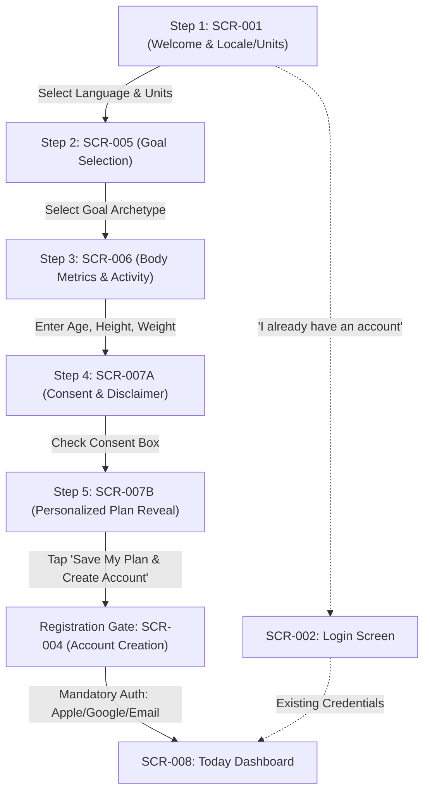
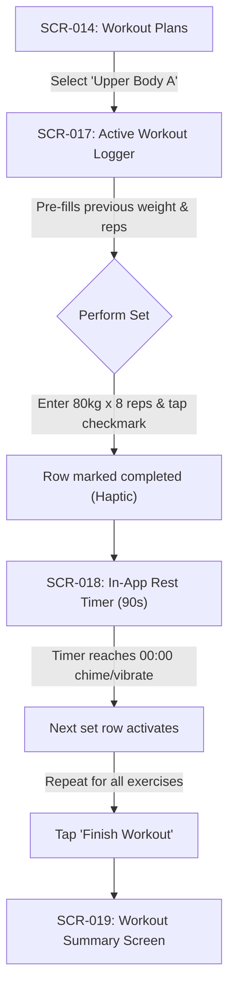

# FitMate AI — User Journeys & Experience Flows

**Document Version:** 2.0.0  
**Phase:** 2 — Product Discovery and Planning (Revised & Approved)  
**Status:** Approved Product Decisions Incorporated  
**Author:** Mobile UI/UX & Product Thinking Agent Skills  

---

## 1. Journey Architecture & Principles

Every user journey in FitMate AI is designed to minimize cognitive overhead, prevent user dead-ends, provide instant optimistic feedback, and operate seamlessly in both **Arabic (RTL)** and **English (LTR)** from the first release.

Each journey specification includes:
- **Starting Point**: Entry trigger and initial context.
- **Step-by-Step Flow**: Chronological user actions and system responses.
- **Key User Decisions**: Branching points and configuration choices.
- **Success Outcome**: Clear definition of task completion.
- **Empty States**: Guidance when no prior data exists.
- **Error States & Recovery**: Graceful handling of invalid inputs or network failures.
- **Associated Screen IDs**: Explicit mapping to [SCREEN_INVENTORY.md](file:///d:/2026/Personal%20Fitness%20&%20AI%20Coach%20Platform/FitMate-AI/docs/product/SCREEN_INVENTORY.md).

---

## 2. Master Journey Directory

| Journey ID | Journey Title | Primary Module | Starting Screen | Outcome Screen |
| :--- | :--- | :--- | :--- | :--- |
| **UJ-001** | New User Registration & 5-Step Onboarding | B. Onboarding | `SCR-001` (Welcome) | `SCR-008` (Today Dashboard) |
| **UJ-002** | Existing User Authentication | A. Auth | `SCR-001` / `SCR-002` | `SCR-008` (Today Dashboard) |
| **UJ-003** | Selecting or Changing a Fitness Goal | B / A. Profile | `SCR-021` (Profile) | `SCR-008` (Today Dashboard) |
| **UJ-004** | Quick-Adding a Meal to the Daily Diary | C. Nutrition | `SCR-009` (Nutrition) | `SCR-009` (Nutrition Diary) |
| **UJ-005** | Searching Local Food Library & Portions | C. Nutrition | `SCR-009` (Nutrition) | `SCR-009` (Nutrition Diary) |
| **UJ-006** | Starting, Executing & Completing Workout| D. Workouts | `SCR-014` (Workouts) | `SCR-019` (Workout Summary) |
| **UJ-007** | Reviewing Progress & Honest Weight Trends| E. Progress | `SCR-008` (Today) | `SCR-020` (Progress Analytics)|
| **UJ-008** | Conversational AI Coach Consultation | F. AI Coach | `SCR-008` (Today) | `SCR-023` (Coach Chat) |
| **UJ-009** | Updating Profile, Metrics & Units | A. Profile | `SCR-021` (Profile) | `SCR-022` (Settings) |
| **UJ-010** | Offline Workout Logging & Resync | D. Workouts | `SCR-017` (Active Workout)| `SCR-008` (Today Dashboard) |

---

## 3. Detailed Journey Specifications

### UJ-001: New User Registration & 5-Step Onboarding
- **Starting Point**: User launches FitMate AI for the first time; cold launch opens `SCR-001` (Welcome & Locale Initializer).
- **Structure**: 5 Progressive Onboarding Steps followed by a Mandatory Registration Gate (`SCR-004`).
- **Associated Screens**: `SCR-001` (Step 1) $\rightarrow$ `SCR-005` (Step 2) $\rightarrow$ `SCR-006` (Step 3) $\rightarrow$ `SCR-007A` (Step 4) $\rightarrow$ `SCR-007B` (Step 5) $\rightarrow$ `SCR-004` (Registration Gate) $\rightarrow$ `SCR-008` (Today Dashboard).
- **Flow Diagram**:

- **Detailed Steps**:
  1. **Step 1: Locale & Units (`SCR-001`)**: User selects preferred language (`English` vs `العربية`) and unit system (`Metric` vs `Imperial`). The entire screen immediately updates its reading orientation (LTR $\leftrightarrow$ RTL) and typography. Returning users can tap *"I already have an account"* to route directly to `SCR-002` (Login). New users tap *"Get Started"*.
  2. **Step 2: Goal Selection (`SCR-005`)**: User reviews 6 interactive cards (Fat Loss, Muscle Gain, Recomp, Maintenance, General Fitness, Undecided). User taps a card; it highlights with primary accent and gentle haptic feedback. User taps *"Continue"*.
  3. **Step 3: Body Metrics & Activity Profile (`SCR-006`)**: User enters biological sex (with "Prefer not to say" option), age, height, current weight, and activity level. Input masks adapt dynamically to selected units (`cm` vs `in`, `kg` vs `lbs`).
  4. **Step 4: Health Consent & Disclaimers (`SCR-007A`)**: User reads the mandatory non-medical disclaimer and data minimization notice. User toggles the consent checkbox acknowledging that calculations are estimates and FitMate AI is not a medical doctor. The *"Reveal My Plan"* CTA activates.
  5. **Step 5: Instant Plan Reveal (`SCR-007B`)**: A 1.2-second pulse animation calculates the baseline. The screen reveals estimated daily calories (`isEstimated: true`), macro rings, and recommended workout cadence. User taps *"Save My Plan & Create Account"*.
  6. **Registration Gate (`SCR-004`)**: User completes mandatory 1-tap sign-up via Apple/Google or enters email and password.
  7. **State Transfer & Completion**: Transient in-memory onboarding state is transmitted via the unauthenticated registration request, atomically committed to MongoDB upon account creation, and purged from client memory upon token receipt. User is routed directly to `SCR-008` (Today Dashboard) with all personalized widgets populated. No unauthenticated Guest Mode is permitted.
- **User Decisions**:
  - Choice of language and units on Step 1.
  - Choice of goal archetype (or "Undecided").
  - Consent approval (mandatory to proceed).
  - Auth provider selection (OAuth vs Email/Password).
- **Success Outcome**: User profile and baseline targets are securely stored in MongoDB; user is authenticated on the Today Dashboard with zero initial setup debt.
- **Error States & Recovery**:
  - *Invalid Body Metrics* (e.g., Weight = 12 kg): Inline red error banner appears below the field: *"Please enter a valid weight between 30 and 300 kg"*. CTA remains disabled until corrected.
  - *Network Drop during Account Creation*: Onboarding state remains in client runtime memory; user is prompted with *"Network unavailable. Tap to retry account creation"* without data loss.

---

### UJ-002: Existing User Authentication
- **Starting Point**: Returning user opens the app logged out, or logs in on a new device.
- **Associated Screens**: `SCR-001` $\rightarrow$ `SCR-002` (Login) $\rightarrow$ `SCR-008` (Today Dashboard) or `SCR-003` (Forgot Password).
- **Detailed Steps**:
  1. User opens `SCR-001` and taps *"I already have an account"* or opens `SCR-002` directly.
  2. User taps *"Sign in with Apple"* / *"Sign in with Google"*, or enters email and password.
  3. Biometric prompt (Face ID / Fingerprint) is offered if previously enrolled on the device.
  4. System validates credentials, issues access/refresh JWTs, and fetches user profile and current day's logs.
  5. User is routed immediately to `SCR-008` (Today Dashboard) without repeating onboarding.
- **Success Outcome**: User authenticated; dashboard populated with synchronized historical data.
- **Error States & Recovery**:
  - *Invalid Credentials*: Inline banner *"Incorrect email or password"*; password field clears, cursor focuses on password.
  - *Forgotten Password*: User taps *"Forgot Password?"* $\rightarrow$ routes to `SCR-003`; enters email $\rightarrow$ receives secure reset link.

---

### UJ-003: Selecting or Changing a Fitness Goal
- **Starting Point**: User's lifestyle or objectives change (e.g., completes a fat-loss phase and wants to transition to muscle gain).
- **Associated Screens**: `SCR-008` (Today) $\rightarrow$ `SCR-021` (Profile) $\rightarrow$ `SCR-005` (Goal Reconfiguration) $\rightarrow$ `SCR-008` (Today).
- **Detailed Steps**:
  1. User navigates to `SCR-021` (Profile) and taps *"Active Goal: Fat Loss (Edit)"*.
  2. Screen `SCR-005` renders with the current goal pre-selected.
  3. User taps *"Muscle Gain"*. A brief summary explains the metabolic shift (transitions from a caloric deficit to a slight caloric surplus with higher protein priority).
  4. User selects their target caloric surplus/deficit pace or accepts the standard recommended estimate.
  5. User taps *"Update Goal & Recalculate Targets"*.
  6. Confirmation dialog appears: *"This will update your daily calorie and macronutrient targets. Your historical logs will remain unchanged."*
  7. User confirms. New daily targets compute immediately with `isEstimated: true`.
  8. User is returned to `SCR-008`, where the nutrition rings reflect the new targets.
- **Success Outcome**: User goal updated in database; new daily caloric and macro targets take effect for today forward without retroactively altering past logs.

---

### UJ-004: Quick-Adding a Meal to the Daily Diary
- **Starting Point**: User finishes lunch at a restaurant and wants to log estimated calories and macros in under 5 seconds without searching a database.
- **Associated Screens**: `SCR-008` (Today) $\rightarrow$ `SCR-009` (Nutrition Diary) $\rightarrow$ `SCR-012` (Quick-Add Modal) $\rightarrow$ `SCR-009`.
- **Detailed Steps**:
  1. User opens the `Nutrition` tab (`SCR-009`).
  2. Under the *"Lunch"* card, user taps the `[+ Quick Add]` button.
  3. A bottom sheet modal (`SCR-012`) opens with focused numeric inputs:
     - Meal Name: *"Chicken Rice Bowl"* (optional, defaults to "Quick Lunch").
     - Calories: `650` kcal (required).
     - Protein: `45` g (optional).
     - Carbs: `70` g (optional).
     - Fat: `18` g (optional).
  4. User taps *"Save Meal"* ($\ge 48\,\text{dp}$ CTA).
  5. Modal dismisses; Lunch card updates immediately via optimistic state; remaining calorie ring animates down by 650 kcal.
- **Success Outcome**: Meal logged to today's diary; progress rings update in real-time; data persists to MongoDB.
- **Empty States**: If no meals have been logged today, the summary ring shows `0 kcal consumed / [Daily Target] remaining` with a friendly prompt: *"Tap + to log your first meal"*.

---

### UJ-005: Searching Local Food Library & Selecting Portions
- **Starting Point**: User wants to log specific items (e.g., Egyptian foul mudammas or Greek yogurt) with verified nutritional breakdowns.
- **Associated Screens**: `SCR-009` (Nutrition Diary) $\rightarrow$ `SCR-010` (Food Search) $\rightarrow$ `SCR-011` (Food Details & Portion) $\rightarrow$ `SCR-009`.
- **Detailed Steps**:
  1. User taps *"Add Food"* under *"Breakfast"* on `SCR-009`.
  2. `SCR-010` (Food Search) opens with keyboard auto-focused.
  3. User types *"Foul"* or *"فول"*. Results list filters in real-time ($<50\,\text{ms}$) from the embedded Local Food Library.
  4. User taps *"Foul Mudammas (Cooked Fava Beans)"*.
  5. `SCR-011` (Food Details) renders showing calories and macros per 100g and common serving units (e.g., "1 Plate / 250g").
  6. User adjusts portion slider or types `200` into the grams field.
  7. Macros scale dynamically: `220 kcal`, `16g Protein`, `38g Carbs`, `2g Fat` (all marked `isEstimated: true`).
  8. User taps *"Add to Breakfast"*.
  9. Screen pops back to `SCR-009`; Breakfast subtotal and daily totals update.
- **Success Outcome**: Verified food item logged from local dataset with calculated portion metrics and `isEstimated: true` flag. Zero external commercial API dependency.
- **Empty States**: When search query yields zero matches, display: *"No matching foods found. Would you like to use Quick-Add to log this meal?"* with a direct CTA button opening `SCR-012` (Quick-Add Modal). *(Note: Reusable custom food creation is deferred for v1.1 evaluation under Q-005).*

---

### UJ-006: Starting, Executing & Completing a Workout
- **Starting Point**: User enters the gym and opens FitMate AI to begin today's training session.
- **Associated Screens**: `SCR-008` (Today) or `SCR-014` (Workout Plans) $\rightarrow$ `SCR-017` (Active Workout Logger) $\rightarrow$ `SCR-018` (Rest Timer Modal) $\rightarrow$ `SCR-019` (Workout Summary).
- **Flow Diagram**:

- **Detailed Steps**:
  1. User taps *"Start Workout"* on `SCR-008` or selects *"Upper Body A"* from `SCR-014`.
  2. `SCR-017` (Active Workout Logger) mounts with keep-awake mode enabled.
  3. Previous session weights/reps (e.g., `77.5 kg x 8`) are pre-populated as subtle reference placeholders.
  4. User performs Set 1, inputs `80` kg and `8` reps, and taps the circular checkmark button ($\ge 48\times 48\,\text{dp}$).
  5. The row turns green with haptic confirmation; total session volume increments.
  6. Rest timer banner (`SCR-018`) docks at the bottom: 90-second countdown begins.
  7. When the timer hits `00:00`, phone emits a double vibration and soft chime; next set row focuses.
  8. User completes all exercises, taps *"Finish Workout"*.
  9. `SCR-019` (Workout Summary) displays: Duration (48 mins), Volume (5,240 kg), sets completed, and congratulatory badge. Session is saved to local storage and queued for background MongoDB sync.
- **Success Outcome**: Complete workout session safely recorded with zero data loss, volume totals updated, and history refreshed.

---

### UJ-007: Reviewing Progress & Honest Weight Trends
- **Starting Point**: User wants to inspect their body weight trend over time.
- **Associated Screens**: `SCR-008` (Today) $\rightarrow$ `SCR-020` (Progress & Analytics).
- **Detailed Steps**:
  1. User navigates to the `Progress` tab (`SCR-020`).
  2. Top card displays the **Weight History & Trend Chart**:
     - **Real Data Points Only**: Only actual recorded weigh-ins are plotted as data points.
     - **No Fabricated Interpolation**: Missing days are displayed as empty gaps; the system never invents fake data points for unmeasured days.
     - **Smoothed 7-Day Moving Average**: The trendline is calculated and rendered only when $\ge 3$ distinct real measurements exist within the time window.
  3. User taps `[+ Log Weight]`, enters `81.4` kg, and saves. Chart updates immediately.
  4. Lower section displays the **Workout Consistency Heatmap** (calendar days highlighted green for completed sessions).
  5. User toggles time range pills: `[1W]`, `[1M]`, `[3M]`, `[1Y]`, `[ALL]`.
- **Success Outcome**: User gains an honest, non-anxious understanding of their physical trajectory based strictly on real measurements.

---

### UJ-008: Conversational AI Coach Consultation (Limited Scope)
- **Starting Point**: User seeks exercise form clarification or a safe exercise substitution.
- **Associated Screens**: `SCR-008` (Today) $\rightarrow$ `SCR-023` (AI Coach Chat).
- **Detailed Steps**:
  1. User navigates to the `AI Coach` tab (`SCR-023`).
  2. Screen displays chat history, clear non-medical disclaimer banner, and quick-prompt pills:
     - `[Explain Romanian Deadlift form]`
     - `[Suggest safe substitute for Leg Press]`
     - `[High-protein snack ideas]`
  3. User types: *"My gym's leg press is broken today, what can I do instead for quads?"*.
  4. Message appears instantly with an outgoing status bubble.
  5. AI Coach processes prompt with authorized user context (Goal: Muscle Gain, Routine: Lower Body) via provider-agnostic adapter.
  6. AI Coach responds (target latency: p90 $< 3.0\,\text{s}$):
     - Suggests evidence-based alternatives: Goblet Squats or Bulgarian Split Squats.
     - Outlines 3 key execution cues.
     - Reminds user: *"Remember, I cannot diagnose injuries or prescribe clinical therapy. Train within safe comfort limits!"*.
  7. **Strict Boundary**: The AI Coach does not autonomously modify the user's active workout plan or change their calorie targets.
- **Success Outcome**: Actionable, context-aware guidance delivered within safe educational boundaries.
- **Error States & Recovery**:
  - *Rate Limit Reached*: *"Hourly limit reached (20 messages). Please check back in 25 minutes."*
  - *Prohibited Query (Medical/Injury/Crash Diet)*: Two-tier guardrail intercepts query and outputs standard non-medical refusal: *"I cannot provide medical advice, evaluate injuries, or prescribe medications. Please consult a qualified physician or physical therapist."*

---

### UJ-009: Updating Profile, Metrics & Preferences
- **Starting Point**: User updates baseline measurements, switches language, or changes units.
- **Associated Screens**: `SCR-021` (Profile) $\rightarrow$ `SCR-022` (Settings).
- **Detailed Steps**:
  1. User opens `Profile` (`SCR-021`) and taps `Settings` (`SCR-022`).
  2. User changes unit preference from `Metric` to `Imperial`. All values across Profile, History, and charts convert dynamically (kg $\leftrightarrow$ lbs).
  3. User changes language from `English` to `العربية`. Interface re-renders dynamically in RTL layout with Cairo typography (+25% line-height).
  4. User updates current body weight or biological activity level.
  5. System confirms changes and recalculates estimated calorie targets with `isEstimated: true`.
- **Success Outcome**: User preferences saved to local settings and synchronized to user document in MongoDB.

---

### UJ-010: Offline Workout Logging & Resynchronization
- **Starting Point**: Trainee enters a basement gym with zero cellular reception and Wi-Fi dead zones.
- **Associated Screens**: `SCR-017` (Active Workout) $\rightarrow$ `SCR-008` (Today Dashboard).
- **Detailed Steps**:
  1. User launches FitMate AI; client detects offline status and switches network layer to local cache mode.
  2. User starts, executes, and logs 5 exercises and 15 sets on `SCR-017`.
  3. Every set completion writes synchronously to local device storage before attempting any network ping.
  4. User taps *"Finish Workout"*. Summary screen displays normally with a non-intrusive badge: *"Saved locally (Offline)"*.
  5. User leaves gym and reconnects to LTE / Wi-Fi.
  6. Background synchronization manager detects active connectivity, pulls pending queue, and POSTs payload to `/api/v1/workouts`.
  7. Server processes payload, stores records in MongoDB, and returns HTTP 201.
  8. Local queue clears; badge updates to *"Synced"*.
- **Success Outcome**: 100% data integrity with zero lost sets or dropped exercises despite complete network blackout.
